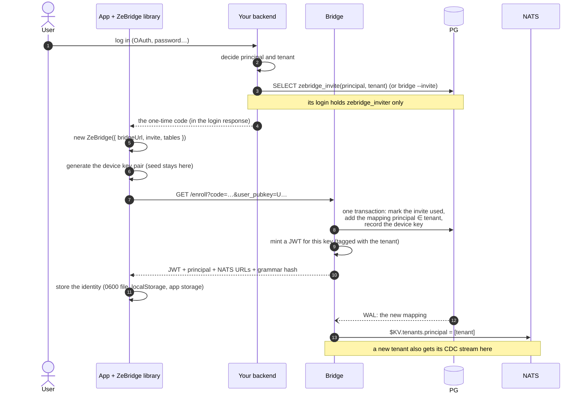
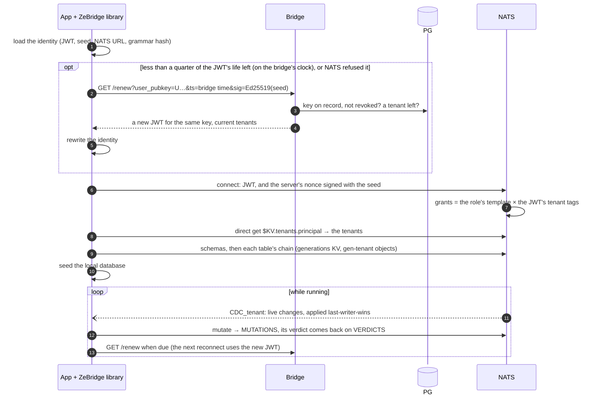

# Authentication

How users, services and sensors get their access to ZeBridge, and which file holds what. The README has the short version; [SECURITY.md](SECURITY.md) has the reasons behind each rule; [DEPLOYMENT.md](DEPLOYMENT.md#the-nats-identity) has the server-side operations (re-signing, rotating a key).

## Table of contents

- [The picture](#the-picture)
- [The files](#the-files)
- [Users: invites](#users-invites)
- [Connect and renew](#connect-and-renew)
- [Services and sensors](#services-and-sensors)
- [Revoke](#revoke)
- [Keep the root key offline](#keep-the-root-key-offline)
- [Who holds what](#who-holds-what)
- [Development](#development)

## The picture

ZeBridge does not log users in: your app does, however it likes (OAuth, passwords, biometrics). ZeBridge needs two things about each user: a name, the **principal** (your user id, an email, any name you choose: letters, digits, `_` and `-`), and the **tenants** this name may use.

Two systems then check every access, each on what it holds:

- **NATS** checks which subjects (the message channels) a user may read or write, from the user's JWT;
- **PostgreSQL** checks which rows a user may read or write: row-level security (RLS) and the tenant guard.

So there are no sync rules to write, and no extra authorization service to run. The user's name travels in the subject of each message, for example `mutation.alice.orders.UPDATE`, and NATS refuses a message whose subject does not match the sender's JWT: the bridge can trust that name, and never trusts a name written inside a message.

Every identity comes from one chain of signatures, NATS's [operator mode](https://docs.nats.io/learn/security/decentralized-auth): the **operator** signs the **account**; the account lists five **signing keys**, one per role (client, responder, service, archiver, sensor); each signing key signs **users**. A signing key holds the permissions of every user it signs, as a template: when the user connects, `{{name()}}` becomes the user's name and `{{tag(tenant)}}` each of their tenants. A JWT holds no permissions, only a name and one tag per tenant.

| role | who | how it gets its identity |
| --- | --- | --- |
| client | a phone, a browser, a desktop or Node app | an invite, redeemed once ([Users: invites](#users-invites)) |
| service | the bridge and the sweeper | `bridge --init-nats operator`, once |
| responder | a service that answers questions | `--mint-responder` ([Services and sensors](#services-and-sensors)) |
| archiver | writes a tenant's sensor readings to S3 | `--mint-archiver` |
| sensor | a device that only publishes readings | `--mint-sensor`: a bearer token |

## The files

### Filled in by the DBA

| file or setting | where | holds |
| --- | --- | --- |
| `.env.bridge` | the bridge's host, 0600, the bridge's user | `DATABASE_READER_URL` and `DATABASE_WRITER_URL` (the bridge's two roles, their passwords inside), `BRIDGE_CDC_SLOT`, `BRIDGE_CDC_PUBLICATION`, `GENERATIONS_ENABLED`, and the bridge's other settings ([OPERATIONS.md](OPERATIONS.md)) |
| `ADMIN_DATABASE_URL` | **never in a file on the server**: given for one command | the DBA's superuser, for `bridge --init-sql \| psql`, `--revoke`, `--view-slots`, `--drop-slot` |
| `INVITER_DATABASE_URL` | the environment of whatever creates invites: your backend, the public demo (`/etc/zebridge/.env.demo` on the hub) | a login granted `zebridge_inviter`: it can create invites and nothing else ([Users: invites](#users-invites)) |

The init SQL (`bridge --init-sql`) creates the bridge's two roles from the names and passwords in `.env.bridge`'s URLs, and the role `zebridge_inviter`, which has no login: the DBA gives it to a login of their own. With Docker Compose, the stack's single `.env` holds all of these ([deploy/compose](deploy/compose/README.md)).

### Generated on the server

`bridge --init-nats operator --dir /etc/zebridge` writes four files, the secret ones with mode 0600:

| file | holds | keep it |
| --- | --- | --- |
| `operator.store` | every seed: the operator, the accounts, the five signing keys | **off the server**, offline ([Keep the root key offline](#keep-the-root-key-offline)) |
| `.env.nats` | `NATS_URL`, `NATS_CREDS` (the path of the bridge's creds), `ZB_SIGNING_SEED` (the **client** signing key: it can mint a client for any principal), `ZB_ACCOUNT_PUB`, `ENROLL_JWT_TTL_SECONDS` | on the bridge's host, readable by the bridge's user only |
| `creds/bridge.creds` | the bridge's own NATS identity, a service-role user: every subject of the account | on the bridge's host, readable by the bridge's user only |
| `nats-server.conf` | the operator's and the accounts' public JWTs: no secret | on the NATS host |

The bridge starts with both env files loaded: `.env.nats` (generated) and `.env.bridge` (the DBA's). They share no setting.

### Minted later, from `operator.store`

A `.creds` file per service, sensor or leaf node, made by a `--mint-…` command ([Services and sensors](#services-and-sensors)). Each holds one identity's JWT and seed: keep it with its process, readable by that process's user only.

## Users: invites

1. **Your app authenticates the user**, however it does that: OAuth, a password, a magic link. ZeBridge is not involved.
2. **Your backend creates a one-time invite** for that user: it decides _who_ (the principal) and _where_ (the tenant), and asks for a code, either from a shell:

   ```sh
   INVITER_DATABASE_URL=postgres://… bridge --invite --principal alice --tenant acme --expires '1 hour'
   ```

   or with one SQL call over its own PostgreSQL connection:

   ```sql
   SELECT zebridge_invite('alice', 'acme', interval '1 hour');
   ```

   Both print the code and run the same function. The login needs one right only, `GRANT zebridge_inviter TO <login>`: it can create invites, and cannot read, spend or delete them, nor touch anything else. An invite lasts 1 day by default, at most 30 days, and a revoked principal gets none. Meanwhile the DBA can create invites the same two ways, with a login granted `zebridge_inviter` or the admin's.
3. **The app passes the code to the library**, on the first connect only. The library then keeps the device's identity and renews it by itself.

| how the code reaches the device | where the app reads it |
| --- | --- |
| in your login response, when the user signs in to your app | the response |
| a link in an email or an SMS: `https://app.example.com/?invite=<code>` | in the browser, the query string |
| the same link on a phone, opened by your app (a universal link on iOS, an app link on Android) | the URL the system hands to the app |
| the user types or pastes the code | a text field |

The library never reads a URL itself. Whatever the source, the app passes the string:

```ts
const zb = new ZeBridge({ bridgeUrl, invite: code, tables });   // libzb: "invite": code in zb_client_connect's options
await zb.connect();
```

Every later start needs no code. The repository's phone examples take the code at build time (`--dart-define=ZB_INVITE=…`, `EXPO_PUBLIC_ZB_INVITE`): a shortcut for testing, not for a published app.

<details>
<summary>What happens at enrollment</summary>



</details>

The device's seed never leaves it. The client never sends its principal or its tenant: `/enroll` reads them from the invite row. An invite for a principal that already exists adds a device, or joins another tenant. Every device enrolled this way is a **client**: the bridge holds the client signing key only.

**A public demo.** `bridge --demo-invites` is a small process that hands each visitor an invite: `GET /demo` creates a one-hour invite for a new principal (`demo-<random>`) in the tenant `demo` and redirects to the demo page with it. It runs with its own `INVITER_DATABASE_URL`, behind a proxy that limits the rate per visitor ([deploy/ansible](deploy/ansible/README.md), role `demo`).

## Connect and renew

Every start is the same, with nothing to configure but the bridge's URL.

<details>
<summary>What happens at each start</summary>



</details>

No secret crosses the wire: NATS sends a nonce, the device signs it with its seed, and NATS checks the signature and the JWT's chain up to the operator. JWTs live `ENROLL_JWT_TTL_SECONDS` (24 h by default). The library renews with a quarter of that left, by proving it holds the device's key, so there is no invite and no backend call. The quarter is counted on the bridge's clock, not the device's: the identity keeps the difference, taken from each JWT's issue time, so a phone with a wrong clock still renews on time. libzb then counts on a clock the phone's settings cannot move, so changing the time while the app runs changes nothing. If its clock moved since, the bridge refuses the stamp and answers with its time, and the library tries once more with it; a JWT that NATS refuses is renewed at once. Only a revoked key, or a principal with no tenant left, needs a new invite.

**Back after a long time offline.** An expired JWT is not a problem: `/renew` asks for proof of the device's key, not for the old JWT, so the library renews before it connects, whether the JWT expired an hour ago or a month ago. The limit that matters is the data's, not the identity's: within `GC_THRESHOLD_MS` (7 days by default), the device catches up through the chain and sends its queued writes; past it, it reloads the base, and the bridge refuses writes queued before the GC watermark (`PredatesGcWatermark`), so the app is told those edits are lost.

| away for | identity | replica | queued writes |
| --- | --- | --- | --- |
| under 24 h | the JWT is still valid; renewed when due | resumes the stream if the stream still holds its position, otherwise catches up through the chain (deltas, checkpoints) | sent; verdicts as usual (`applied`, `rebased`, `lost`…) |
| 24 h to 7 days | `/renew` first, then connect | catches up through the chain: the stream keeps events only `3 × cadence`, so it has rolled past its position | the same |
| over 7 days (`GC_THRESHOLD_MS`) | `/renew` first, then connect | reloads the base: a delete it missed may have had its tombstone reaped, and only a base proves a row is gone | refused (`rejected`, `PredatesGcWatermark`); the local copy is put back and the edit reported lost |
| revoked, or no tenant left | `/renew` refused: a new invite is needed (with `--purge`, the device deletes its replica and identity) | — | — |

The same flow runs for every consumer (web app, phone, microservice) and in every language ([the first ten lines](CLIENTS.md#the-first-ten-lines)). Only the transport (WebSocket in the browser, TLS-TCP elsewhere) and the identity's storage differ.

## Services and sensors

These identities are not enrolled: they are minted from `operator.store`, on the machine that holds it, and only the resulting `.creds` file goes to the server. A mint connects to nothing: a copy of the `bridge` binary runs it anywhere libpq and zstd are installed. Mint each with its own name and tenant:

```sh
bridge --mint-responder --store operator.store --name pois          --tenant acme > pois.creds
bridge --mint-archiver  --store operator.store --name archiver-acme --tenant acme > archiver-acme.creds
bridge --mint-sensor    --store operator.store --name boiler-12     --tenant acme > boiler-12.creds
```

- A **responder** answers the questions clients ask on `query.<tenant>.<name>`, from its own replica. It reads like a client and never writes: its signing key grants no `mutation.*` subject, so NATS refuses a write from its creds.
- An **archiver** belongs to one tenant: it reads that tenant's sensor readings (`READINGS_<tenant>`) and writes that tenant's archive manifest, nothing else ([examples/16-archive](examples/16-archive)).
- A **sensor** publishes its own readings, `sensors.<tenant>.<name>.>`, and reads nothing. Its identity is **a bearer token**: whoever holds it is that sensor. Over MQTT, its JWT (the first block of the creds file) is the password, with any user name. Without `--tenant`, it belongs to the open tenant `_default`.

Services' creds are valid ten years by default (`--ttl-days`): a service is replaced with a redeploy, not renewed. A new tenant needs nothing new: its grants are the template, filled with the tenant tag the JWT carries.

The processes on a hub, and what each holds (`<t>` is a tenant):

| process | NATS identity | minted by | file | may do | other keys |
| --- | --- | --- | --- | --- | --- |
| bridge and sweeper | the service key | `--init-nats`, once | `/etc/zebridge/creds/bridge.creds` | everything (`>`): the trusted writer | the database passwords, in `.env.bridge` |
| `zb-respond` (routing) | responder `routing`, tenant `_default` | the Ansible `routing` role | `/etc/zebridge/creds/routing.creds` | answer `query._default.*`, read like a client; no writes | none |
| archiver, one per tenant | archiver `archiver-<t>` | `--mint-archiver --name archiver-<t> --tenant <t>` | `/etc/zebridge/creds/archiver-<t>.creds` | read `READINGS_<t>`, write `<t>`'s manifest; nothing else | an S3 key that can **write** the bucket |
| readings responder, one per tenant | responder `readings-<t>` | `--mint-responder --name readings-<t> --tenant <t>` | `/etc/zebridge/creds/readings-<t>.creds` | answer `query.<t>.*`, read `READINGS_<t>` and its manifest; no writes | an S3 key that can only **read** the bucket |
| the public demo's front door | none: it reaches PostgreSQL only | the DBA (`GRANT zebridge_inviter TO <login>`) | `/etc/zebridge/.env.demo` | create invites; nothing else | none |

Off the hub:

| who | NATS identity | how it gets it | may do |
| --- | --- | --- | --- |
| a sensor | sensor `<name>`, one tenant (a bearer JWT) | `--mint-sensor`, copied to the device | publish `sensors.<t>.<name>.>`; read nothing |
| a phone or a browser | a client, per device | `/enroll` with an invite; the device makes its own key | its tenants' data, its own writes, `query.<t>.*` |
| a leaf node | the leaf link | `leaf.yml` (`--mint-leaf`) | carry its devices' traffic, `mutation.>` and `sensors.>` |
| an app's backend | none: it reaches PostgreSQL only, as a login granted `zebridge_inviter` | the DBA (`GRANT zebridge_inviter TO <login>`) | create invites; nothing else |

- The archiver and the readings responder run as uid 10001 in their containers: their creds file must belong to that uid, mode 0600, or the container cannot read it: `… --mint-archiver … | sudo install -m 0600 -o 10001 -g 10001 /dev/stdin /etc/zebridge/creds/archiver-<t>.creds`.
- Their S3 keys come from the bucket's provider (an R2 API token's key pair), not from ZeBridge. They go in an env file read by `docker run --env-file` (mode 0600), never on a command line, where `ps` and the shell's history would show them. Give the responder its own read-only key: a compromised responder then cannot change the archive.

## Revoke

Three ways to take a user's access away, the strongest first:

| you run | the user's devices | can the same name come back? |
| --- | --- | --- |
| `bridge --revoke <principal>` | writes refused at once; apps on the ZeBridge libraries disconnect at once; other code can read until its current JWT expires: its remaining life, at most `ENROLL_JWT_TTL_SECONDS` (24 h by default), since `/renew` refuses it | no, invite a new principal |
| `bridge --revoke <principal> --conf …` <br> then reload nats-server | cut off at once: NATS refuses the token | no, invite a new principal |
| add `--purge` to either | the same, and the devices delete their local replica and stored identity: a connected one at once, a returning one when it reconnects or renews its JWT | no, invite a new principal |
| `DELETE FROM zebridge_user_tenants WHERE principal = '…'` | the same as `--revoke` | yes: `INSERT` the mapping back and access returns at once |

The commands take their keys from the environment, for the command only:

```sh
ADMIN_DATABASE_URL=postgres://… bridge --revoke omar
```

```sh
# also close the token at NATS (OPERATOR_SEED is in operator.store, ZB_ACCOUNT_PUB in .env.nats)
OPERATOR_SEED=SO… ZB_ACCOUNT_PUB=A… ADMIN_DATABASE_URL=postgres://… \
  bridge --revoke omar --conf /etc/zebridge/nats-server.conf
nats-server --signal reload
```

⚠️ `bridge --revoke --key U…` adds one key to NATS's revocation list. NATS refuses the JWTs issued up to the revocation, not after it, and an enrolled device would renew. So for an enrolled device's key, pass `ADMIN_DATABASE_URL` too: the key is then also marked in PostgreSQL, and `/renew` refuses it. The principal's other devices keep working; a new device for it needs a new principal, as after any revocation. Identities minted offline (services, sensors, leaves) never renew and need no database.

Without `--purge`, the rows already on a device stay there until the app calls `wipe()` (`zb_client_wipe` in libzb). With `--purge`, the libraries delete them themselves. The promise holds only for a device that reconnects: one that never comes back keeps its data, and a modified client can ignore the instruction. It protects against lost or handed-on devices running the real app, not against someone who already copied the database file.

## Keep the root key offline

`operator.store` signs everything else, like the private key of a certificate authority, and nothing running needs it: the bridge, nats-server and the devices work without it. Keep it offline (a password manager, an encrypted disk), and bring it to a **trusted machine**, any machine you control, only to:

- mint a service's, a sensor's or a leaf's creds: `--mint-responder`, `--mint-archiver`, `--mint-sensor`, `--mint-leaf`, with `--store <path>`;
- cut a revoked user off at NATS: `--revoke --conf` (it needs `OPERATOR_SEED`, from the store);
- re-sign the account after a grammar change, or replace a leaked `ZB_SIGNING_SEED` ([DEPLOYMENT.md](DEPLOYMENT.md#the-nats-identity)).

Then copy what the command wrote to the server: the new `.creds`, or the updated `nats-server.conf`.

- 🔔 If `operator.store` leaks, anyone can sign an account: generate a new stack, and every device enrolls again.
- 🔔 If `ZB_SIGNING_SEED` leaks, anyone can make a client JWT for any user and any tenant: replace it with `--init-nats --rotate-client-key` ([DEPLOYMENT.md](DEPLOYMENT.md#the-nats-identity)).

## Who holds what

| | holds | can |
| --- | --- | --- |
| you, offline | `operator.store`: every seed | re-sign the account, mint services, sensors and leaves |
| nats-server | the operator JWT and the account JWTs | check every user's chain of signatures, apply its role's template |
| the bridge | its own service creds + the **client** signing seed (`ZB_SIGNING_SEED`) | run the pipeline; mint client users only, never an admin |
| a backend, the demo | a login granted `zebridge_inviter` | create invites |
| a device | its own seed + its JWT | be itself, in its tenants |
| a service or a sensor | its `.creds` | its role's subjects, in its tenant |

## Development

### `dev` mode

`bridge --init-nats dev` writes an open NATS server: no authentication, and enrollment off. Map each user to a tenant directly:

```sql
INSERT INTO zebridge_user_tenants (principal, tenant_id) VALUES ('alice', 'acme');
```

A client then names itself:

```ts
const zb = new ZeBridge({ natsUrl: 'ws://localhost:8080', principal: 'alice', tables: ['orders'] });
```

(`nats://localhost:4222` from Node or libzb). NATS checks nothing here, so any client can claim any principal: never expose a `dev` server.

### Your own NATS server, without operator mode

If you run your own nats-server with nkey authentication, the bridge needs an nkey pair:

```sh
bridge --gen-nkey >> .env.bridge
```

It appends both keys to `.env.bridge`:

```diff
+ NATS_BRIDGE_NKEY_PUB=UDZXDNW7BZUWYV3Y3WVV2NRG5ERSXZOPNQDVMVNSSMUC4OBGXRO3UTJ4
+ NATS_BRIDGE_NKEY_SEED=SUAPVJBFH7MWPQA4SJQTSP3QGXSZMWAWDOPKUIUAUALFS66X2DBIXQGVME
```

Put the public key in the server's config, then start it:

```json
authorization {
  users: [
    { nkey: $NATS_BRIDGE_NKEY_PUB }
  ]
}
```

```sh
export NATS_BRIDGE_NKEY_PUB=UD...
envsubst < nats-server.conf.template > nats-server.conf
nats-server -js -m 8222 -c nats-server.conf
```

Invites and token renewal need operator mode, so on such a server the clients connect the way your server allows.

### This repository's test stack

It pre-mints fixed principals with `scripts/native/jwt-bootstrap.sh`:

```sh
scripts/native/creds/{alice,bob,mary,nina,omar,bridge,zbdoctor}.creds
```

Anything that reads `NATS_CREDS` points at one:

```sh
NATS_CREDS=scripts/native/creds/zbdoctor.creds bridge --diagnose
NATS_CREDS=scripts/native/creds/omar.creds     python3 scripts/scenarios/mutate.py
```
