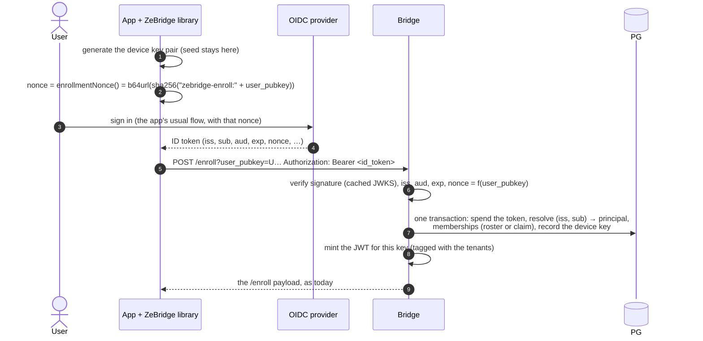

# Enrollment with an OIDC token (proposal)

**Status: a design, nothing implemented.** When it lands, the user-facing part moves into [AUTHENTICATION.md](AUTHENTICATION.md) and this file keeps the reasons.

An app that already signs its users in with an OpenID Connect provider (Auth0, Cognito, Entra ID, Google, Keycloak, Zitadel…) holds a signed statement of who the user is: the **ID token**. Today it must still ask its backend for an invite and pass the code to the library ([Users: invites](AUTHENTICATION.md#users-invites)). This proposal lets the library hand the ID token to `/enroll` instead, and the bridge checks it itself. Invites stay exactly as they are.

## Table of contents

- [What changes, what does not](#what-changes-what-does-not)
- [The flow](#the-flow)
- [Configuration](#configuration)
- [Checking the token](#checking-the-token)
- [Binding the token to the device key](#binding-the-token-to-the-device-key)
- [Who the user is: the principal](#who-the-user-is-the-principal)
- [Where the user may go: the tenants](#where-the-user-may-go-the-tenants)
- [Renew, revoke, purge](#renew-revoke-purge)
- [The signing keys (JWKS)](#the-signing-keys-jwks)
- [Clients](#clients)
- [What this does not cover](#what-this-does-not-cover)
- [Tests](#tests)
- [Phases](#phases)
- [Open questions](#open-questions)

## What changes, what does not

| | invite (today) | OIDC token (proposed) |
| --- | --- | --- |
| proof presented at `/enroll` | a one-time 122-bit code, made by your backend | an ID token signed by your provider, bound to the device key |
| your backend at enrollment | creates the invite, ships the code to the app | **not involved**, except to pre-provision memberships in roster mode |
| who decides the tenant | the invite row | the roster (`zebridge_user_tenants`), or a token claim ([tenants](#where-the-user-may-go-the-tenants)) |
| device key, JWT, `/renew`, revoke, purge | — | **unchanged**: after `/enroll` the two paths are the same |
| trust added | your backend's inviter login | your provider, and the issuer/audience written in the bridge's config |

The steady state does not move: the device keeps its own key, renews by signing with it, and never calls the provider or your backend again. Only the step that turns "the app knows who this is" into "this key belongs to principal X in tenants Y" changes.

## The flow



Steps 6 onwards are the current `/enroll` (`src/http_server.zig`, `handleEnroll`): one transaction on the writer connection, `rosterTenants`, `jwt_mint.mint`, `putTenantMapping`, `identityPayload`. Only how the principal and its memberships are found differs.

## Configuration

Set in `.env.bridge`, next to the bridge's other settings. No setting means OIDC enrollment is off: `POST /enroll` with a bearer token answers `404 {"error":"oidc enrollment not configured"}`.

| setting | example | meaning |
| --- | --- | --- |
| `OIDC_ISSUER` | `https://acme.eu.auth0.com/` | the `iss` the token must carry, compared byte for byte. Discovery reads `<issuer>/.well-known/openid-configuration` |
| `OIDC_AUDIENCE` | `k3J…` (the app's client id) | the `aud` the token must contain. Comma-separated for several apps (iOS, Android, web) |
| `OIDC_JWKS_URL` | — | optional: overrides the `jwks_uri` from discovery |
| `OIDC_ALGS` | `RS256,ES256` (default) | accepted algorithms. `none` and `HS*` are never accepted, whatever is written here |
| `OIDC_TENANTS` | `roster` (default) or `claim` | where the memberships come from ([tenants](#where-the-user-may-go-the-tenants)) |
| `OIDC_TENANT_CLAIM` | `org_id`, `tid`, `custom:tenant`, `groups` | claim mode only: the claim holding the tenant (a string) or tenants (an array of strings) |
| `OIDC_TENANT_PATTERN` | `^acme-[a-z0-9]+$` | claim mode only, required: a claimed tenant outside it is ignored. Stops a provider-side typo or a self-service group from opening a tenant |
| `OIDC_PRINCIPAL_PREFIX` | `o-` (default) | claim mode only: prefix of auto-named principals |
| `OIDC_KEY_NONCE` | `required` (default) or `off` | [binding the token to the device key](#binding-the-token-to-the-device-key) |
| `OIDC_MAX_TOKEN_AGE_SECONDS` | `3600` | refuse a token whose `iat` is older, even if `exp` is later |

One issuer per bridge. Several issuers (a B2B app whose customers each bring their own Entra tenant) is an [open question](#open-questions).

`bridge --diagnose` gains: discovery reachable, JWKS loaded (key count, algorithms), `OIDC_TENANT_PATTERN` present in claim mode, a tenant pattern that admits a value the tenant check refuses (`.`, `*`, `>`, over `tenant_bytes`).

## Checking the token

In this order, each failure a `401` with a short reason and a `🎟️ oidc enrollment refused: <reason>` warning (the log line the scenario greps):

1. Three base64url parts; header `alg` in `OIDC_ALGS`; `typ`, if present, is `JWT`. Never take the algorithm from anything but this allow-list (no `alg: none`, no RS/HS confusion).
2. `kid` found in the cached JWKS, with a key type matching `alg`. Unknown `kid`: one refresh of the JWKS (rate-limited, below), then refuse.
3. Signature: RS256 with `std.crypto.Certificate.rsa.PKCS1v1_5Signature.verify` and `rsa.PublicKey.fromBytes(e, n)` from the JWK; ES256 with `std.crypto.sign.ecdsa.EcdsaP256Sha256` (raw `r‖s`, 64 bytes). Both exist in Zig 0.17's standard library; no new dependency.
4. `iss` equals `OIDC_ISSUER`. `aud` (string or array) contains one of `OIDC_AUDIENCE`; with several audiences, `azp`, if present, is one of ours.
5. `exp` in the future, `nbf` and `iat` not in the future, each with 60 s of skew; `iat` not older than `OIDC_MAX_TOKEN_AGE_SECONDS`.
6. `nonce` ([binding](#binding-the-token-to-the-device-key)).
7. `sub` present, 1–255 bytes.
8. **Spent once.** `sha256(token)` is inserted into `zebridge_oidc_spent (token_hash PRIMARY KEY, expires_at)` in the enrollment's transaction; a conflict refuses. The sweeper reaps rows past `expires_at`. Without this, a token copied off the device could enroll a second key for as long as it lives.

The token arrives in the `Authorization` header of a `POST`, never in the query string: the current `GET /enroll?code=…` puts its secret in URLs, which proxies log. A one-time code spent at once is little loss in a log; an ID token valid an hour is more. A browser then sends a CORS preflight (`OPTIONS`) for the header, so the server answers it on `/enroll`.

## Binding the token to the device key

An ID token is a bearer token. Steps 1–7 prove *who signed in*, not *which device is asking*. Spending it once (step 8) stops a second use, but not a first use by whoever got it first (a malicious SDK, a log, a compromised proxy).

So the device key exists before the sign-in, and the app puts it into the token through OIDC's own replay guard, the `nonce`:

```
nonce = base64url(sha256("zebridge-enroll:" + user_pubkey))
```

The provider copies the nonce into the ID token it signs; the bridge recomputes it from the `user_pubkey` of the request. A stolen token then enrolls nothing but the key it was made for, and that key's seed never left the device.

The libraries expose the value (`enrollmentNonce()`) and generate and keep the device key before it, so the app passes it to its sign-in SDK. Most native and web SDKs accept a nonce (AppAuth, Auth0, MSAL, Google Credential Manager). Some token sources do not let the app choose it (Firebase Authentication's ID tokens, some `client_credentials` setups): for those, `OIDC_KEY_NONCE=off`, and the protection falls back to single use and the token's age, which the boot line and `--diagnose` state as a warning.

## Who the user is: the principal

OIDC's stable identity is the pair **(`iss`, `sub`)**; an email can change and be reused. A principal is `[A-Za-z0-9_-]+` (`zebridge_invites_principal_check`) and must not start with the leaf prefix. `sub` often fits nothing of that: Auth0's `auth0|65a…`, Google's 21 digits are fine, an email is not. So the bridge never derives the principal by cleaning up a claim (two subjects could clean up to the same name). It keeps a mapping table:

```sql
CREATE TABLE public.zebridge_identities (
    issuer    text NOT NULL,
    subject   text NOT NULL,
    principal text NOT NULL UNIQUE,   -- same CHECK as zebridge_invites.principal; no leaf namespace
    created_at timestamptz NOT NULL DEFAULT now(),
    PRIMARY KEY (issuer, subject)
);
```

- **Roster mode:** the row is created in advance by the app's backend or the DBA, with a principal they choose (the app's own user id), through a new `SECURITY DEFINER` function granted to `zebridge_inviter`:

  ```sql
  SELECT zebridge_grant_identity(p_issuer, p_subject, p_principal, p_tenant);
  ```

  It inserts the identity row (or checks it maps to the same principal) and the membership, refusing a revoked principal like `zebridge_invite` does. It is done once per *user*, at sign-up or when they join a tenant, not per device and not on the login path, so the backend is not in the device's onboarding.
- **Claim mode:** a missing row is created at enrollment with `principal = OIDC_PRINCIPAL_PREFIX || lower(base32(sha256(issuer || '\0' || subject)))[0..20]`: stable, no collision in practice, fits the alphabet. An operator finds it with `SELECT principal FROM zebridge_identities WHERE subject = '…'`.

The bridge's writer role gets `SELECT, INSERT` on `zebridge_identities`, nothing more: remapping an identity to another principal is an admin act.

## Where the user may go: the tenants

The JWT's tenant tags must equal the roster, or a client writes rows it cannot read back (§10fn). So in both modes the **roster stays the only truth** the mint reads (`rosterTenants`); the modes differ only in who writes it.

**`roster` (the default).** The token proves identity, nothing else. The principal's memberships are whatever `zebridge_user_tenants` holds. No membership: `403 {"error":"no tenant membership"}`, and **no key is recorded**. This matters with a public provider: anyone with a Google account can get a token for your client id, and roster mode turns each such stranger away before anything is written.

**`claim`.** The provider holds the memberships (Auth0 Organizations' `org_id`, Entra's `tid`, Keycloak groups, a Cognito custom attribute). At enrollment the bridge inserts every claimed tenant that matches `OIDC_TENANT_PATTERN` and the tenant check into the roster, in the same transaction, then mints from the roster as usual. It **adds and never removes**: removing a membership the token no longer lists would let any re-enrollment with a stale or partial token cut a user out of tenants granted by other means (an invite, the DBA). Taking a tenant away stays a ZeBridge act (`DELETE FROM zebridge_user_tenants …` or `bridge --revoke`).

That is the honest limit of claim mode: **removing a user from an organization at the provider does not remove them from ZeBridge.** The device renews without the provider, by design (offline renewal is the point of `/renew`). An app that offboards at the provider pairs it with a hook (Auth0 Actions, Entra provisioning, a SCIM endpoint) that deletes the roster row, which the bridge carries to `$KV.tenants` and to the next `/renew` as today.

A claimed tenant creates its CDC stream through the roster's replication path, as an invite's does; nothing new there.

## Renew, revoke, purge

Unchanged, because enrollment ends with the same row in `zebridge_principal_keys` and the same JWT.

- `/renew` signs with the device key; no ID token, no provider call. A device enrolled with OIDC renews offline for as long as an invited one.
- `bridge --revoke <principal>`: the principal is dead for good (§10dm). An OIDC enrollment for an identity mapped to a revoked principal is refused like an invite for it (the same `NOT EXISTS … revoked_at` arm). So revoking bans the person's *provider identity*, which is what an operator means. Letting them back is an admin `UPDATE zebridge_identities SET principal = '<new>'`, the same "new principal" rule as today.
- `--purge` reaches the device through `/renew`, as today.

## The signing keys (JWKS)

- Fetched at boot (discovery, then `jwks_uri`), refreshed every 6 h and on an unknown `kid`, at most once a minute. A failed refresh keeps the keys in hand and logs a warning. Keys rotated out at the provider are dropped at the next successful refresh.
- Fetched off the request path, by a small thread using `std.http.Client` (already used by `archive_s3.zig`). It registers its `errdefer should_stop.store(true)` **after** its `defer join` (CLAUDE.md, "A bridge that is up but silent").
- Provider unreachable at boot: OIDC enrollment answers `503 {"error":"provider keys not loaded"}` until the first fetch succeeds; invites, `/renew` and replication are not affected. The bridge does not refuse to start over its provider.
- Bounded: at most 16 keys, 8 KiB per key, 64 KiB per document; RSA moduli 2048–4096 bits.

## Clients

Both twins, the same words in their log lines:

```ts
const zb = new ZeBridge({ bridgeUrl, tables, idToken: () => signIn({ nonce: zb.enrollmentNonce() }) });
await zb.connect();
```

- `idToken` is a function, not a string: the library calls it only when it has no identity (first start, or after a refused `/renew`), so the app signs in only when needed, with the nonce of the key the library now holds.
- libzb: `"id_token"` in `zb_client_connect`'s options, and `zb_client_enrollment_nonce()` in the C ABI, which generates and stores the device key if there is none yet. The wrappers (`zb-python`, `zb-dart`, `zb-android`, `zb-react-native`, Swift) pass both through.
- `invite` and `idToken` together: refused at configuration, so an app never wonders which one enrolled it.
- After `/renew` answers `403` (revoked, or no membership left), the library calls `idToken` once more; a second `403` is final and reported, as today.

## What this does not cover

- **Leaf principals** (`lf-<leaf>.<device>`): enrollment through a leaf stays invite-only. A leaf scope's tenant list is an admin registration, and a provider claim must not reach into it.
- **Services and sensors**: they keep minted `.creds` ([Services and sensors](AUTHENTICATION.md#services-and-sensors)). A provider's `client_credentials` token is a machine identity whose rotation the provider owns; mapping it onto a ten-year `.creds` is a different design.
- **Access tokens.** Only ID tokens, whose audience is the app. An access token's audience is an API, and accepting one would let any API in the same provider tenant enroll devices.
- **NATS auth callout.** Considered and set aside: it would accept the provider's token at every NATS connect, putting a callout service on the connect path and losing the offline renewal.

## Tests

Each fails without its part of the change (CLAUDE.md: restore the old code to prove it).

- Unit (`src/oidc.zig`): RS256 and ES256 vectors from RFC 7515/7520; `alg: none`, `HS256` with the RSA modulus as the secret (the confusion attack), wrong `kid`, wrong `iss`, `aud` missing ours, `azp` foreign, expired, `nbf`/`iat` in the future, too old, bad nonce, oversized JWKS, a modulus under 2048 bits.
- SQL: `zebridge_grant_identity` refuses a revoked principal, a leaf namespace, a second principal for the same `(iss, sub)`; the spent table refuses a replay inside its transaction.
- Scenario `scripts/scenarios/oidc_enroll.py`, private stack, with a fake provider: a 60-line Python HTTP server serving discovery and a JWKS, signing tokens with a key it generates (needs `cryptography` in the scenario venv). Cases: roster mode enrolls a pre-provisioned identity and syncs its tenant; a stranger is refused and leaves no key row; claim mode with a pattern; a replayed token; a token for another key's nonce; key rotation at the provider (new `kid` mid-run); provider down at boot (invites still work, OIDC `503` then recovery); revoke, then the same identity refused; `/renew` after the provider is gone, still working. The same flow with a zb-client-ts client and a libzb client.

## Phases

1. **Roster mode**: token check, nonce binding, spent table, `zebridge_identities`, `zebridge_grant_identity`, JWKS thread, `POST /enroll`, both clients, `--diagnose`, scenario. This alone removes the code shuttle for every app with a provider.
2. **Claim mode**: tenant claim, pattern, auto-named principals.
3. Whatever the open questions settle.

## Open questions

- **Several issuers.** A table (`zebridge_oidc_issuers`) instead of env settings, so a B2B app adds a customer's Entra tenant without a restart. Each row needs its own audience and tenant rules; the JWKS thread then holds one cache per issuer.
- **Pre-provisioning by verified email.** B2B admins invite `bob@acme.com`, not a `sub` they cannot know yet. `zebridge_grant_email(email, principal, tenant)`, bound to `(iss, sub)` at the first enrollment whose token has that email and `email_verified: true`, then never by email again. Worth it, but email binding has known traps (providers that do not verify, an address reassigned), so it is a separate decision.
- **Should `GET /enroll?code=` move to `POST` too**, for the same reason as the token? A compatible change (accept both for a release), independent of this proposal.
