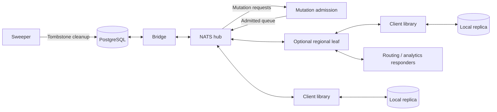

# ZeBridge

**Local PostgreSQL replicas for apps and services, over NATS.**

ZeBridge keeps a local database on each device, queues writes while it is offline, and synchronizes through NATS when it reconnects. PostgreSQL remains authoritative: it applies the rules, resolves conflicting writes, and returns a verdict to the app.

The client library provides one interface to read the local replica, submit mutations, and query remote responders such as routing or analytics services. Optional regional NATS leaves serve snapshot caches near devices and host those services.

[Try it](#try-it-with-docker)
[Build an app](#build-an-app)
[Deploy](#deploy)
[Documentation](#documentation)

## Try it with Docker

You need Docker Compose. No repository clone or local build is required.

```sh
curl -O https://raw.githubusercontent.com/ndrean/ZeBridge/main/docker-compose.quickstart.yml
docker compose -f docker-compose.quickstart.yml up
```

This starts PostgreSQL, NATS, the bridge, its tombstone-cleanup process (the sweeper), and two browser demos using published images. This evaluation Compose file has no separate mutation admission service; the production layout described below includes one. The Compose file selects the image version; it does not build the current repository checkout.

When the `init` service prints the invite links, open these in separate tabs:

| Link | Device |
| --- | --- |
| <http://localhost:5173/?invite=quickstart-alice-1> | Alice, tenant `acme` |
| <http://localhost:5173/?invite=quickstart-alice-2> | A second Alice device, tenant `acme` |
| <http://localhost:5173/?invite=quickstart-bob-1> | Bob, tenant `globex` |

Each invite is single-use. The tab creates its own device key, enrolls with the bridge, and receives scoped NATS credentials. Wait for the four phase badges to turn green; the first snapshots can take up to a minute.

**See tenant isolation.** Change `counter_tenant` in an Alice tab: the other Alice tab follows, while Bob's does not. Change `counter_public`: all three follow. The page also demonstrates foreign keys, refused writes and cooperative editing.

**Try offline writes.** Keep the tabs open, then stop the services:

```sh
docker compose -f docker-compose.quickstart.yml down
```

Click the counters while disconnected. Each tab reads its own local replica and keeps its pending writes in an outbox. Start the services again:

```sh
docker compose -f docker-compose.quickstart.yml up
```

The tabs reconnect, submit their queued writes and catch up. Counters use last-writer-wins: the final value is the winning write, not the sum of offline clicks.

The initialization log also prints links to a shared-record demo on port 5174. It shows several editors changing separate fields of the same record.

To erase this evaluation stack and start again, run `docker compose -f docker-compose.quickstart.yml down -v`. This removes its database and NATS volumes, including the identities those invites depend on. The quick start uses local evaluation settings without NATS TLS; use the deployment guides for a server.

## Build an app

The usual flow is: your backend authenticates a user and issues an invite; the library enrolls the device, stores its identity, seeds its replica, and follows changes. Later connections reuse that identity and renew its credentials.

For a browser app:

```sh
npm install @zebridge/client
```

```ts
import { ZeBridge } from '@zebridge/client';

// Your backend supplies the invite. The DBA has enabled the orders table.
const zb = new ZeBridge({
  bridgeUrl: 'https://bridge.example.com',
  invite: code,
  tables: ['orders'],
});

zb.onChange('orders', () => refreshOrders());
zb.onVerdict(verdict => showWriteOutcome(verdict));
await zb.connect();

// SQL reads the local replica, including while offline.
const orders = await zb.query(
  'SELECT id, status FROM orders WHERE status = ?',
  'pending',
);

// Mutations apply optimistically and enter the durable outbox.
if (orders.length > 0) {
  await zb.mutate('orders', 'UPDATE', { id: orders[0].id }, { status: 'done' });
}
```

`query()` reads local data. `mutate()` owns the write path: local changes, versioning, the outbox, retries and verdicts. Completing `mutate()` does not mean PostgreSQL has accepted the write; handle its outcome through the library. Use `request()` to query a remote responder, and `ingest()` when its answer should be retained locally.

The TypeScript client drives its own synchronization loop. With native `libzb`, the host drives `sync()` and `poll()`; see the binding's example for its threading or worker model.

| Host | Package | Local database |
| --- | --- | --- |
| Browser | `@zebridge/client` | SQLite in OPFS or PGlite |
| Node | `@zebridge/client`, `better-sqlite3`, `@nats-io/transport-node` | SQLite or PGlite |
| Python | `zebridge` | SQLite, PostgreSQL or DuckDB through libzb |
| Dart / Flutter | `zebridge` | libzb; see the binding's platform support |
| React Native | `@zebridge/react-native` | SQLite through libzb; requires a native build |
| Android / Kotlin / Java | `eu.zebridge:zebridge-android` | SQLite through libzb |
| Other native hosts | libzb's C ABI | SQLite, PostgreSQL or DuckDB |

The native core is written in Zig. The TypeScript client reuses shared core rules through WebAssembly; the platform bindings wrap libzb rather than implementing another synchronization engine.

Start with [the first calls in each language](CLIENTS.md#the-first-ten-lines), then use [CLIENTS](CLIENTS.md) for options, lifecycle and differences between clients. Installation and platform artifacts are covered in [DISTRIBUTION](DISTRIBUTION.md).

## How it works

The hub runs NATS and three ZeBridge processes. They have separate responsibilities:

| Process | Responsibility |
| --- | --- |
| Bridge (`bridge`) | Reads PostgreSQL changes, builds snapshots, manages enrollment, and applies admitted mutations to PostgreSQL. |
| Mutation admission (`bridge --mutation-ingress`) | Validates incoming mutation requests and enforces per-principal queue budgets before storing them for the bridge to process. |
| Sweeper (`bridge_sweeper`) | Advances the database's GC floor, then reaps the tombstones older than it. One active sweeper per database. |



- **Changes:** the bridge reads PostgreSQL's logical replication feed and publishes schemas and changes to NATS JetStream. Connected clients apply those changes to their local databases.
- **Seeding and recovery:** the bridge builds compressed snapshot chains per table and tenant: fulls and deltas. Clients fetch these from NATS and follow CDC after the chain's cut. Eligible reconnects can use deltas to replace a larger CDC backlog.
- **Writes:** clients publish mutation requests to NATS. The separate admission process validates them and bounds each principal's queued work. The bridge consumes admitted writes, applies them to PostgreSQL and records durable receipts with their outcomes. Matching retries reuse the receipt rather than committing the mutation again.
- **Housekeeping:** the sweeper holds a database-wide lock, advances the GC floor (a watermark that never goes down: a write stamped before it is refused, not replayed) and then reaps tombstones older than it, under one retention (`GC_THRESHOLD_MS`) for the whole database. A second sweeper idles. See [the floor](PROTOCOL.md#the-floor-one-per-database-and-it-never-goes-down).
- **Services:** responders answer requests over NATS, using their own replica or an external service. A routing responder can wrap Valhalla; an analytics responder can query DuckDB.

Devices seed from shared snapshot objects rather than querying PostgreSQL individually. This keeps a connection storm from becoming a snapshot-query storm on the primary database. PostgreSQL still carries mutation execution and the bridge's snapshot-building work.

### Optional leaves

Start with a hub. Add leaves when regional connections, seed traffic or services justify them.

A seeding leaf runs its own JetStream domain and mirrors the authorized tenants' snapshot data. Clients can download fulls and deltas locally; authoritative CDC streams, mutation processing and verdicts remain at the hub. Leaves can also host responders near their users.

This offloads snapshot serving and client connections. It does not make the hub highly available or move authoritative writes to a region. Enrollment supplies an assigned leaf followed by the hub for ordered connection failover; a live connection to a leaf with a broken hub link is a separate failure case. See [leaf boundaries, configuration and fallback behavior](LEAF_NODES.md).

## Deploy

You need PostgreSQL with logical replication and the privileges needed to install ZeBridge's SQL objects, plus a server for NATS, the bridge, mutation admission and the sweeper. PostgreSQL may be managed and run on another machine; keep its network latency to the bridge in mind.

| Route | Guide |
| --- | --- |
| Hub with Docker Compose | [Compose deployment](deploy/compose/README.md) |
| Hub on a Debian VPS with systemd | [Ansible deployment](deploy/ansible/README.md) |
| Manual installation and managed PostgreSQL | [DEPLOYMENT](DEPLOYMENT.md) |
| A managed PostgreSQL, from an empty project (Supabase) | [SUPABASE_TEST](SUPABASE_TEST.md) |
| Optional regional leaves | [LEAF_NODES](LEAF_NODES.md) |

The setup establishes NATS identities and TLS, installs the database functions and roles, enables the tables, starts admission, the bridge and the sweeper, and issues device invites. Follow the selected deployment guide rather than combining initialization commands from different layouts.

Before starting or after changing configuration, run `bridge --diagnose` with the same environment and credentials as the service. It reads the database, NATS and the bridge's status without changing them. In Compose:

```sh
docker compose exec bridge sh -c \
  'set -a; . /etc/zebridge/.env.nats; set +a; bridge --diagnose'
```

Use [OPERATIONS](OPERATIONS.md#diagnose) to interpret the report, including checks skipped because a service is unavailable. Diagnosis is a configuration and health check, not proof that every device has converged. For upgrades, follow the [receipt upgrade order](OPERATIONS.md#upgrading-mutation-receipts): install the matching SQL before starting the new bridge workers.

### Prepare your tables

Use `zebridge_enable()` to declare each table's replication and write rules. Its `dry_run` mode reports schema requirements before enabling the table. Run `bridge --diagnose` to check the wider deployment.

Writable tables need deliberate choices about keys, versions, tenants and deletes. Client-generated UUIDs support offline inserts; version stamps resolve competing writes; tombstones preserve deletions for absent devices. Row widths and schema descriptors must fit the bridge's configured buffers and NATS payload limits.

See [database schema requirements](SECURITY.md#13-postgresql-what-the-schema-must-satisfy), [migrations](MIGRATIONS.md), and [configuration and sizing](OPERATIONS.md#configuration).

## Scaling and availability

The supported architecture is offline-capable clients, optional regional seeding leaves, and **a single active hub** (PostgreSQL, NATS, the bridge, mutation admission and the sweeper) under supervised restart. It is not automatic high availability, and running duplicate containers would not make it one safely. Offline operation buys time; it does not remove the retention and storage limits below.

**One bridge deployment per database is the recommended setup.** More than one is a constrained configuration, for what it does buy: different table sets, isolated workloads or deployment lifecycles, or separate NATS deployments from one PostgreSQL database. It is not HA, a second bridge following the same tables adds no useful throughput, and every extra bridge adds replication, snapshot and coordination cost. The constraints (one shared GC policy and one sweeper per database, one publication per table) are in [DEPLOYMENT](DEPLOYMENT.md#running-more-than-one-bridge).

What an outage of one component does (each row is played by `scripts/scenarios/outage_matrix.py`: the effect while the component is down, and that the hub converges when it is back; how *long* it may stay down depends on queue retention and storage limits that are still to be verified under load):

| Unavailable | Expected effect |
| --- | --- |
| Bridge | PostgreSQL changes stop reaching clients; mutation execution and generation building pause. |
| Admission | New mutations cannot enter the queue; clients keep them locally and retry. |
| Sweeper | Cleanup pauses; storage pressure grows with the length of the outage. |
| Hub NATS | Hub CDC and mutation transport stop. Leaves can serve cached seeds and reachable regional responders, within the trust-staleness policy ([LEAF_NODES](LEAF_NODES.md)). |

A supported deployment means restart policies and health monitoring (the Compose file sets `restart: unless-stopped`; the Ansible route runs under systemd), disk alerts, durable NATS volumes and preserved credentials, PostgreSQL backups with point-in-time recovery suited to the deployment, and a documented procedure to rebuild the hub on another machine with its recovery time measured and the data a restore can lose stated ([hub checkpoints and recovery](OPERATIONS.md#hub-checkpoints-and-recovery)). Restarting a process handles a crash; rebuilding elsewhere handles losing the server, and a drilled restore from a real backup is still open work. Automatic failover would need NATS clustering, PostgreSQL availability and explicit coordination of bridge ownership and background work; it can come if users need recovery in seconds rather than an operator-led restoration. Leaves add seeding capacity, not hub availability.

## Fit and boundaries

ZeBridge fits mobile apps, intermittently connected devices, field equipment and services that benefit from local SQL reads. The [depot example](examples/14-depot/README.md) uses trucks, shared plans and routing; the same pattern applies to equipment working through periods of poor connectivity.

- **Replication is tenant-based.** A followed table brings the tenant's rows into the replica. A local SQL `WHERE` clause filters what the app reads, not what the device receives. One tenant per consumer at B2C scale is outside the intended topology.
- **PostgreSQL is the authority.** Offline writes are provisional until judged by the server. This is not peer-to-peer or multi-master replication.
- **Conflict semantics are explicit.** Ordinary writes use last-writer-wins. Cooperative editing can merge per-field registers; it is not collaborative text editing. See [COOPERATIVE_EDITING](COOPERATIVE_EDITING.md).
- **Recovery has retention requirements.** CDC retention, chain availability, tombstone GC and mutation receipt retention serve different purposes. An offline duration that permits reads to recover does not automatically permit every old pending write to execute: a write stamped before the GC floor is refused, because the tombstone that would have overruled it may be gone. See [catching up](OPERATIONS.md#catching-up-the-chain-and-the-stream) and [indeterminate write recovery](PROTOCOL.md#74c-reconciling-an-indeterminate-write).
- **Local persistence matters.** Deleting a replica or reinstalling an app can destroy unsent writes. Protect device identity and storage as application data.
- **Operate NATS and PostgreSQL deliberately.** Credentials, replication slots, disk budgets, backups and restore procedures are part of the deployment.

See [SCOPE](SCOPE.md) for the boundaries and [SECURITY](SECURITY.md) for tenant isolation, permissions and revocation.

## Examples

| Explore | Example |
| --- | --- |
| Local reads, optimistic writes and refused mutations | [Tables demo](examples/05-tables) |
| Large replicas and mobile seeding | [Large table](examples/06-large-table/README.md) |
| A DuckDB replica | [DuckDB](examples/07-duckdb/README.md) |
| Mutations and analytical queries under load | [Events](examples/09-event/README.md) |
| Routing through a responder | [Valhalla routing](examples/13-routing/README.md) |
| Shared plans, a map and routing | [Depot](examples/14-depot/README.md) |
| Several editors on one record | [Shared record](examples/15-shared-record/README.md) |
| Archiving readings to Parquet | [Archive](examples/16-archive/README.md) |

## Testing and performance

[TEST_SCENARIOS](TEST_SCENARIOS.md) describes the scenarios and what each checks. The repository includes client fixtures, database and authorization checks, recovery scenarios, and load harnesses. Consult the code and tests when a reference document disagrees with the implementation.

Measure CDC distribution, snapshot download/apply, mutation commits and outbox recovery separately. They have different bottlenecks. Results depend on the build, database latency, disk, lane count, principal count and recovery load; a historical peak is not a deployment capacity guarantee. The [event ramp](examples/09-event/README.md) and [storm harness](storm/README.md) provide starting points for evaluating your topology; [SPEED_TEST](SPEED_TEST.md) is one measured example, with its machine and load stated.

### Measured

Each figure is one run on the hardware named, not a capacity guarantee.

| What | Figure | Conditions | Details |
| --- | --- | --- | --- |
| The bridge, PostgreSQL → NATS | ~100k events/s in Docker, 200k+ native | Apple M2 Pro, a 2,000,000-row burst, PostgreSQL and NATS on the same host | [SPEED_TEST](SPEED_TEST.md) |
| A client applying a busy table live | libzb ~50k events/s, zb-client-ts ~33k | one Mac, a table under a steady write load | |
| A change reaching a replica | median 12 ms | dev stack on one Mac, libzb on the DuckDB engine | |
| Seeding a large table on a phone | libzb 35.0 s (React Native), 70.8 s (Flutter); JavaScript client 725 s | iPhone 12, the same table | [Large table](examples/06-large-table/README.md) |
| Client writes into PostgreSQL | ~8,500 writes/s on one ingress lane, ~19,500 on four; median verdict 11 ms at 20,000/s | one Mac | [the ramp](examples/09-event/README.md#the-ramp-how-far-one-mac-goes) |
| 500 clients starting at once, empty replicas | all synced, the slowest in 8.6 to 12 s; NATS at 140–165 % CPU, about 1 MB per client; PostgreSQL under 16 % CPU; the bridge near idle | 2-vCPU, 3.7 GB VPS, clients 100 ms away | [storm](storm/README.md) |
| The same 500, replicas already seeded | all synced in 5.0 s | same | |
| One write reaching all 500 | median 288 ms, p95 491 ms (100 ms of it network) | same | |
| NATS restarted under the 500 | none lost; half back within 6 s, the last at 23 s | same | |
| 100 clients through a leaf across the Atlantic | cold sync median 13.2 s, slowest 14.7 s; warm 1.7 s; after a NATS restart, longest gap 2.9 s, none lost | 0.2.8 test hub in Canada, clients on a Mac in Europe (~100 ms) | |
| The bridge's memory under a steady stream | ~8 MB resident, allocation flat over 70 minutes | 20,246 ticks of insert, update, delete | `scripts/scenarios/drip.py` |

**Not measured:** a comparison with another sync system on the same workload; how long each component may stay down before recovery needs a re-seed; NATS memory at a steady load (it follows recent load, not stored data); a long network partition under load.

## Documentation

| Task | Reference |
| --- | --- |
| Install and connect PostgreSQL | [DEPLOYMENT](DEPLOYMENT.md) |
| Diagnose, tune, upgrade, back up and recover | [OPERATIONS](OPERATIONS.md) |
| Integrate a client library | [CLIENTS](CLIENTS.md) |
| Enroll, renew and revoke identities | [AUTHENTICATION](AUTHENTICATION.md) |
| Understand permissions and table rules | [SECURITY](SECURITY.md) |
| Add regional caches and responders | [LEAF_NODES](LEAF_NODES.md) |
| Change schemas and datasets | [MIGRATIONS](MIGRATIONS.md) |
| Configure metrics and logs | [OBSERVABILITY_TELEMETRY](OBSERVABILITY_TELEMETRY.md) |
| Understand the wire and recovery contracts | [PROTOCOL](PROTOCOL.md), [GENERATION](GENERATION.md) (a client's position on the tenant and public streams) |
| Check platform artifacts and packaging | [DISTRIBUTION](DISTRIBUTION.md) |
| Assess scope and tested behavior | [SCOPE](SCOPE.md), [TEST_SCENARIOS](TEST_SCENARIOS.md) |
| Edit one record from several places | [COOPERATIVE_EDITING](COOPERATIVE_EDITING.md) |
| Read the design log (numbered `§` sections that code comments cite) | [NOTES](NOTES.md) |

## Build from source

Published packages and images are the simplest starting point. To work on the implementation, use the repository's Zig 0.17 toolchain requirements and dependency pins in `build.zig.zon`. The NATS client is a submodule: the fork `ndrean/nats.zig`, branch `zebridge` (upstream plus our patches, one commit each); see [DISTRIBUTION](DISTRIBUTION.md) for platform builds and packaging, [PG](PG.md) for the `pgoutput` binary formats the bridge decodes, and [CLAUDE.md](CLAUDE.md) for a map of the tree, the build and test commands and the scenarios that act as the real tests.

ZeBridge is licensed under [Apache 2.0](LICENSE).
