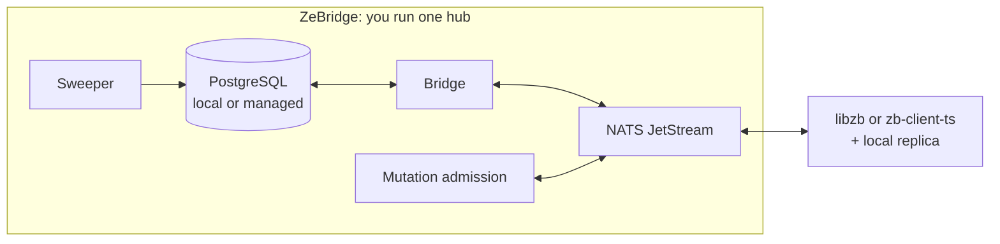
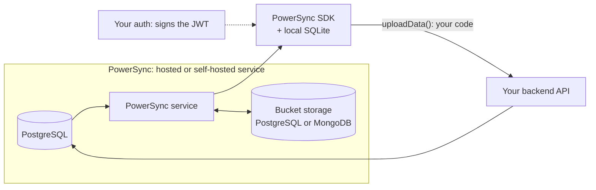
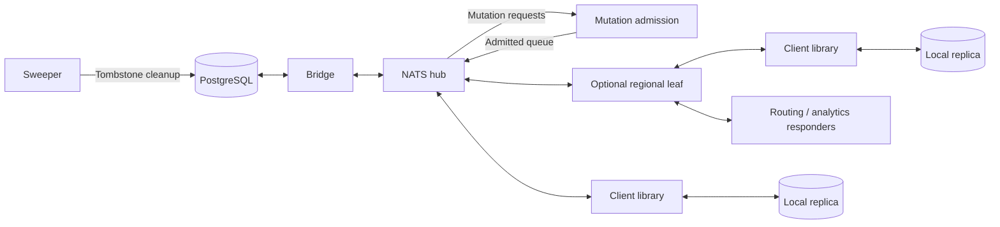

# ZeBridge

**Local PostgreSQL replicas for apps and services, over NATS.**

<p align="center">

</p>

 [](https://opensource.org/licenses/Apache-2.0) [](https://github.com/ndrean/zebridge/blob/main/TEST_SCENARIOS.md)

ZeBridge keeps a local database on each device, queues writes while it is offline, and synchronizes through NATS when it reconnects. PostgreSQL remains authoritative: it applies the rules, resolves conflicting writes, and returns a verdict to the app.

The client library provides one interface to read the local replica, submit mutations, and query remote responders such as routing or analytics services. Optional regional NATS leaves serve snapshot caches near devices and host those services.

**Strongest use cases:** B2B operational apps, where each customer organisation is a tenant (a column in your schema) whose devices share a working dataset: field teams, fleets, depots, sites. They keep working on poor connections or while a team is cut off, and every write still ends with an authoritative decision from PostgreSQL. It is not built for consumer (B2C) apps with one tenant per user.

**See it running: <https://bridge.zebridge.eu/demo>.** Five trucks on a map of France's 16,173 charge points. Pick a truck and a destination, and it drives along the road on every open screen; change its destination from any screen and it turns from where it is. The chargers are a query on the browser's own replica, the route comes from a routing service over the same NATS connection, and PostgreSQL holds only the decisions. Open it in two tabs, or on a phone and a laptop: each visit gets its own identity in a shared demo tenant, from a one-hour invite. How it is built: [the depot example](examples/14-depot/README.md).

- [Try it](#try-it-with-docker)
- [Build an app](#build-an-app)
- [Compared with PowerSync and ElectricSQL](#compared-with-powersync-and-electricsql)
- [Deploy](#deploy)
- [Documentation](#documentation)

## Try it with Docker

You need Docker Compose. No repository clone or local build is required.

```sh
curl -O https://raw.githubusercontent.com/ndrean/ZeBridge/main/docker-compose.quickstart.yml
docker compose -f docker-compose.quickstart.yml up
```

This starts PostgreSQL, NATS, the bridge, its tombstone-cleanup process (the sweeper), and two browser demos using published images. This evaluation Compose file has no separate mutation admission service; the production layout described below includes one. The Compose file selects the image version; it does not build the current repository checkout.

When the `init` service prints the invite links, open these in separate tabs:

| Link                                               | Device                               |
| -------------------------------------------------- | ------------------------------------ |
| <http://localhost:5173/?invite=quickstart-alice-1> | Alice, tenant `acme`                 |
| <http://localhost:5173/?invite=quickstart-alice-2> | A second Alice device, tenant `acme` |
| <http://localhost:5173/?invite=quickstart-bob-1>   | Bob, tenant `globex`                 |

Each invite is single-use. The tab creates its own device key, enrolls with the bridge, and receives scoped NATS credentials. Wait for the four phase badges to turn green; the first snapshots can take up to a minute.

**See tenant isolation.** Change `counter_tenant` in an Alice tab: the other Alice tab follows, while Bob's does not. Change `counter_public`: all three follow. The page also demonstrates foreign keys, refused writes and cooperative editing.

**Try offline writes.** Keep the tabs open, then stop the services:

```sh
docker compose -f docker-compose.quickstart.yml down
```

Click the counters while disconnected. Each tab reads its own local replica and keeps its pending writes in an outbox. Start the services again:

```sh
docker compose -f docker-compose.quickstart.yml up
```

The tabs reconnect, submit their queued writes and catch up. Counters use last-writer-wins: the final value is the winning write, not the sum of offline clicks.

The initialization log also prints links to a shared-record demo on port 5174. It shows several editors changing separate fields of the same record.

To erase this evaluation stack and start again, run `docker compose -f docker-compose.quickstart.yml down -v`. This removes its database and NATS volumes, including the identities those invites depend on. The quick start uses local evaluation settings without NATS TLS; use the deployment guides for a server.

## Build an app

Three parts: the hub, which you install; your backend, which signs users in and issues invites; and the app, which uses the client library on the local database you choose. Services your apps can ask, such as routing or analytics, are optional and run as separate processes on the same library.

### Install the hub

The hub is NATS, the bridge, mutation admission and the sweeper on one server. PostgreSQL can run on the same server or be managed elsewhere (it needs logical replication). Two routes are ready to use:

- **Docker Compose:** two files on the server. HAProxy and Let's Encrypt are included, and PostgreSQL optionally:

  ```sh
  V=0.3.2
  mkdir zebridge && cd zebridge
  curl -fsSLO https://raw.githubusercontent.com/ndrean/ZeBridge/v$V/deploy/compose/compose.yml
  curl -fsSL -o .env https://raw.githubusercontent.com/ndrean/ZeBridge/v$V/deploy/compose/.env.example
  chmod 600 .env
  # In .env: three domain names, the Let's Encrypt e-mail and the passwords (see the guide).
  docker compose up -d
  ```

  The first start issues the certificates, generates the NATS identities and installs ZeBridge's SQL objects, including `zb_inviter`, the login your backend uses below. See [the Compose guide](deploy/compose/README.md).

- **Ansible**, for a Debian VPS with systemd services: fill in the inventory and the vault, then `ansible-playbook site.yml --ask-vault-pass`. It can be run again at any time and changes only what differs. See [the Ansible guide](deploy/ansible/README.md).

Then enable your tables ([Prepare your tables](#prepare-your-tables)) and check the hub with `bridge --diagnose`. Other routes, such as a manual install or Supabase, are listed in [Deploy](#deploy).

### Your backend: sign in, then invite

**Your backend has one job: sign users in, then issue invites.** ZeBridge does not authenticate users, and it does not care how you do it: OAuth, passwords, magic links, any language or framework. After your backend has signed a user in, it decides the user's principal and tenant and asks PostgreSQL for a one-time invite code, with a login that can create invites and nothing else. That is the only server code you write: there is no write API or sync endpoint to build, because writes go through the library and PostgreSQL's own rules judge them.

```ts
// Your backend, after it has signed the user in. Its database login holds only zebridge_inviter.
const { rows } = await db.query(
  "SELECT zebridge_invite($1, $2, interval '1 hour') AS code",
  [user.id, user.tenant],
);
return { invite: rows[0].code }; // in the login response
```

### The app

The app passes the code to the library on its first start. The library enrolls the device, stores its identity, seeds its replica and follows changes; later starts need no code, and the library renews the device's credentials by itself. See [Users: invites](AUTHENTICATION.md#users-invites) for other ways to deliver the code (a link, an email) and the enrollment steps.

For a browser app:

```sh
npm install @zebridge/client
```

```ts
import { ZeBridge } from "@zebridge/client";

// From your own login flow; only the first start needs it. The DBA has enabled the orders table.
const { invite } = await signIn(email, password);

const zb = new ZeBridge({
  bridgeUrl: "https://bridge.example.com",
  invite,
  tables: ["orders"],
});

zb.onChange("orders", () => refreshOrders());
zb.onVerdict((verdict) => showWriteOutcome(verdict));
await zb.connect();

// SQL reads the local replica, including while offline.
const orders = await zb.query(
  "SELECT id, status FROM orders WHERE status = ?",
  "pending",
);

// Mutations apply optimistically and enter the durable outbox.
if (orders.length > 0) {
  await zb.mutate("orders", "UPDATE", { id: orders[0].id }, { status: "done" });
}
```

`query()` reads local data. `mutate()` owns the write path: local changes, versioning, the outbox, retries and verdicts. Completing `mutate()` does not mean PostgreSQL has accepted the write; handle its outcome through the library. Use `request()` to query a remote responder, and `ingest()` when its answer should be retained locally.

The TypeScript client drives its own synchronization loop. With native `libzb`, the host drives `sync()` and `poll()`; see the binding's example for its threading or worker model.

### Write order: what waits for what

⚠️ On tables that support ordering, a write waits by default for this client's most recent unsettled ordered write. That lets you queue an order and then its lines without a line overtaking the order. Use `after` to name a specific earlier write from the same client. Use `independent` for a write such as a page view that can be judged in any order. It can still wait for a free lane or a database lock.

The default is also a constraint: a slow write (a long trigger, a lock) delays later writes that depend on it, directly or through the tail. Ordering never spans clients: a line written on a phone cannot wait for an order written on a laptop.

**The default needs nothing.** Write in the order your data depends on:

```ts
await zb.mutate("orders", "INSERT", { id: 1 }, { id: 1, customer: "acme" });
await zb.mutate("order_lines", "INSERT", { id: 10 }, { id: 10, order_id: 1, qty: 3 });
// order_lines #10 is judged after orders #1. If orders #1 is refused, #10 is still judged,
// and PostgreSQL refuses it in turn on its foreign key: nothing runs out of order.
```

**`after`: wait for a specific earlier write.** Use it when the parent is not the write you made just before. Get the parent's ID with `mutateWithId()`:

```ts
const order = await zb.mutateWithId("orders", "INSERT", { id: 2 }, { id: 2, customer: "globex" });
await zb.mutate("customers", "UPDATE", { id: 7 }, { last_seen: now });  // unrelated
// Without `after`, this line would wait for the customer update above. With it, it waits for the order.
await zb.mutate("order_lines", "INSERT", { id: 20 }, { id: 20, order_id: 2, qty: 1 }, { after: order.writeId });
```

**`independent`: no predecessor.** Use it for a write that depends on no earlier write and can be judged in any order:

```ts
await zb.mutate("page_views", "INSERT", { id: viewId }, { id: viewId, page: "/orders" }, { independent: true });
```

The same in Python, where `mutate` returns the write's ID as `msgId`:

```python
order = zb.mutate("orders", "INSERT", {"id": 2}, {"id": 2, "customer": "globex"})
zb.mutate("order_lines", "INSERT", {"id": 20}, {"id": 20, "order_id": 2, "qty": 1}, after=order["msgId"])
zb.mutate("page_views", "INSERT", {"id": view_id}, {"id": view_id, "page": "/orders"}, independent=True)
```

What to know:

- `after` means "wait for that write's verdict", not "only if it succeeded". A refused parent still lets its child be judged; your foreign keys decide what happens to the child.
- Two writes can name the same parent, for example two lines of one order. Either may be judged first. A later write without options follows whichever of them was made last, not both.
- An ID is returned only for a write that was queued. A write refused on the device before it was queued (for example, one older than what the server still keeps) has no ID: `mutateWithId()` rejects, so nothing can be made to wait for it.
- `after` and `independent` work on tables whose bridge offers ordering, which a current bridge does for every writable table. `after` is refused on a table that does not offer it, and so is an ID that is not one of this device's writes.

The details are in [Clients: ordering a write](CLIENTS.md#ordering-a-write) and the protocol in [PROTOCOL, Ordered ingress](PROTOCOL.md#ordered-ingress-version-1).

### Choose the local database

The replica is a real database on the device, and the app reads it with that database's SQL:

- **SQLite**, the default everywhere: a file on phones, desktops and Node, OPFS in the browser.
- **PGlite**, PostgreSQL compiled to WebAssembly, in the browser or Node (`engine: 'pglite'`): the same SQL dialect as the server.
- **DuckDB**, through libzb (`engine: "duckdb"`): an analytical replica for dashboards and services, which DuckDB can open directly once libzb closes it.
- **PostgreSQL**, through libzb (`dbUrl`): a server-side replica, for a service that wants the full PostgreSQL.

The table below shows which host offers which; [CLIENTS](CLIENTS.md) has the options and the type mapping for each engine.

| Host                    | Package                                                         | Local database                                |
| ----------------------- | --------------------------------------------------------------- | --------------------------------------------- |
| Browser                 | `@zebridge/client`                                              | SQLite in OPFS or PGlite                      |
| Node                    | `@zebridge/client`, `better-sqlite3`, `@nats-io/transport-node` | SQLite or PGlite                              |
| Python                  | `zebridge`                                                      | SQLite, PostgreSQL or DuckDB through libzb    |
| Dart / Flutter          | `zebridge`                                                      | libzb; see the binding's platform support     |
| React Native            | `@zebridge/react-native`                                        | SQLite through libzb; requires a native build |
| Android / Kotlin / Java | `eu.zebridge:zebridge-android`                                  | SQLite through libzb                          |
| Other native hosts      | libzb's C ABI                                                   | SQLite, PostgreSQL or DuckDB                  |

The native core is written in Zig. The TypeScript client reuses shared core rules through WebAssembly; the platform bindings wrap libzb rather than implementing another synchronization engine.

### Connect a service, if you need one

A **responder** is a service your apps can ask questions: routing, search, analytics, an external API. It is a separate process built on the same client library: it connects to NATS with its own identity, keeps its own replica if it needs data, and answers `query.<tenant>.<name>`. Any client of that tenant can call it, and none needs an HTTP endpoint, a URL or another credential:

```ts
// The service, in its own process: a client opened with credsPath: 'pois.creds'
// (minted by `bridge --mint-responder --name pois --tenant acme`) instead of an invite.
await service.serve({
  tenants: ["acme"],
  handlers: { nearby: ({ lat, lon }, tenant) => findNearby(lat, lon) },
});

// Any app of tenant acme.
const pois = await zb.request("query.acme.nearby", { lat: 47.2, lon: -1.55 });
```

Several instances of a responder share the load (one NATS queue group), and a responder can run on a regional leaf, near its users. It can read but never write: NATS refuses a mutation from its identity. `ingest()` keeps an answer in the app's replica. See [Services and sensors](AUTHENTICATION.md#services-and-sensors) for the identities, and the [routing example](examples/13-routing/README.md) for Valhalla served this way.

Start with [the first calls in each language](CLIENTS.md#the-first-ten-lines), then use [CLIENTS](CLIENTS.md) for options, lifecycle and differences between clients. Installation and platform artifacts are covered in [DISTRIBUTION](DISTRIBUTION.md).

## Compared with PowerSync and ElectricSQL

[ZeBridge](https://github.com/ndrean/ZeBridge), [PowerSync](https://www.powersync.com) and [Electric's Postgres Sync](https://electric.ax/docs/sync/) all sync PostgreSQL data to clients. PowerSync and ZeBridge provide client libraries built around local SQLite replicas; Electric exposes HTTP Shapes that a client library or integration materializes into a local store. They differ in where the write path lives, what you run, and how applications connect to other services.





The Electric column summarizes its documented architecture. We tested its read-side seed path below with TanStack DB and Node SQLite; we did not test its write behavior, tenant authorization, or other client platforms.

|                                       | ZeBridge                                                                                                                                        | PowerSync                                                                                                            | ElectricSQL / Postgres Sync (documented) |
| ------------------------------------- | ----------------------------------------------------------------------------------------------------------------------------------------------- | -------------------------------------------------------------------------------------------------------------------- | --- |
| What you run                          | NATS, the bridge, admission and the sweeper on one server                                                                                       | The PowerSync service and its bucket storage, or their hosted cloud                                                  | Electric Sync ([self-hosted or Electric Cloud](https://electric.ax/docs/sync/)); it connects to Postgres and serves HTTP Shapes |
| Server code you write                 | Your sign-in, then one SQL call per invite                                                                                                      | Your sign-in, a JWT signer the service trusts, and the write API that applies each upload                            | For tenant-scoped access, an auth proxy/gatekeeper that validates identity and constrains Shapes; your API handles writes ([auth](https://electric.ax/docs/sync/guides/auth), [writes](https://electric.ax/docs/sync/guides/writes)) |
| Table schema on the client            | Sent by the bridge                                                                                                                              | Declared again in the app                                                                                            | Shape rows can be dynamic; TanStack's Electric adapter requires a key accessor, while its validation schema is optional ([adapter docs](https://tanstack.com/db/latest/docs/collections/electric-collection)) |
| Reads                                 | SQL on the local replica                                                                                                                        | SQL on the local replica                                                                                             | HTTP Shapes, materialized by a client or integration into its local store |
| Writes                                | `mutate()`; the library sends them, PostgreSQL judges them and returns a verdict                                                                | Plain SQL on local tables; your `uploadData()` sends them to **your backend**, which applies its own rules           | No built-in write path in Electric Sync; use your API. TanStack DB can add optimistic mutations and reconcile them with synced changes |
| Exactly once, authorization, refusals | Built in: receipts, tenant credentials and row-level security, a verdict per write                                                              | Your backend's job; the SDK retries until `uploadData()` succeeds                                                    | Your API owns write guarantees; a proxy/gatekeeper must enforce authorization for Shapes |
| Services for the app                  | Responders on the same NATS connection and credentials, on the hub or a regional leaf ([Connect a service](#connect-a-service-if-you-need-one)) | No built-in equivalent: services are your own APIs, reached outside the sync connection and authenticated separately | No built-in NATS responder model; call your own APIs or services |
| Client platforms                      | Browser, Node, Python, Dart/Flutter, React Native, Android, C ABI                                                                               | Many mature SDKs, including web, React Native, Flutter, Kotlin, Swift and Node                                       | TypeScript/JavaScript client and integrations; the local store and persistence depend on the chosen stack |

**Read-side cold seed, same local PostgreSQL:** ten clients per system, 50,000 rows of about 200 bytes, each client starting with an empty SQLite database. The timer includes transfer and local materialization, and stops when all rows are queryable. Every replica matched the same SHA-256 checksum.

| Client path | Median per-client seed, two rounds | Slowest client, two rounds |
| --- | ---: | ---: |
| ZeBridge / libzb | **3.076 s / 2.959 s** | **3.094 s / 2.963 s** |
| PowerSync / Node SDK | 12.76 s / 12.99 s | 13.00 s / 13.14 s |
| Electric / TanStack DB / Node SQLite | 12.052 s / 11.481 s | 18.548 s / 17.636 s |

On these runs, ZeBridge's median seed time was about **4.2–4.4× lower than PowerSync's** and **3.7–4.1× lower than Electric's**. This is a client-side seeding result, not a general throughput claim. Server-side state was warm for the timed rounds: ZeBridge's snapshot chain was ready, PowerSync had a one-client readiness seed, and Electric's second round reused the shape created in its first. The clients ran on the same 8-core Mac under OrbStack, which exposed about 4 GB to Docker; sync services ran one at a time. PowerSync's test stream used the fixed tenant predicate `tenant_id = 'cmp'`, so this does not compare per-user authorization. Full methodology, versions, checksum and startup sensitivity: [local seed comparison](COMPARISON.md#local-cold-seed-zebridge-powersync-and-electric).

**Measured, same workload:** 500 clients, one Supabase database, the same table rules for both (2026-11-02).

|                                                                                                      | ZeBridge                                                        | PowerSync                                                       |
| ---------------------------------------------------------------------------------------------------- | --------------------------------------------------------------- | --------------------------------------------------------------- |
| **Delivery:** 500 clients starting cold receive the 10,000-row table, median (excluding local apply) | **5.3–5.7 s**: one shared compressed snapshot, 0.23 MB a client | 61–76 s: every operation of the bucket, 4.63 MB a client        |
| **Writes,** offered at 1,000/s / 2,000/s                                                             | 990/s, verdict median 0.69 s / 1,572/s                          | 879/s through PostgREST, acknowledgement median 4.8 s / 1,702/s |
| **A write reaching every client,** one write to each of the 500, median                              | **0.4–0.8 s**                                                   | 0.7–1.6 s                                                       |

The configurations, both servers' figures, what the runs do not measure, and what a disconnect does to a write in each are in [COMPARISON](COMPARISON.md).

## How it works

The hub runs NATS and three ZeBridge processes. They have separate responsibilities:

| Process                                          | Responsibility                                                                                                               |
| ------------------------------------------------ | ---------------------------------------------------------------------------------------------------------------------------- |
| Bridge (`bridge`)                                | Reads PostgreSQL changes, builds snapshots, manages enrollment, and applies admitted mutations to PostgreSQL.                |
| Mutation admission (`bridge --mutation-ingress`) | Validates incoming mutation requests and enforces per-principal queue budgets before storing them for the bridge to process. |
| Sweeper (`bridge_sweeper`)                       | Advances the database's GC floor, then reaps the tombstones older than it. One active sweeper per database.                  |



- **Changes:** the bridge reads PostgreSQL's logical replication feed and publishes schemas and changes to NATS JetStream. Connected clients apply those changes to their local databases.
- **Seeding and recovery:** the bridge builds compressed snapshot chains per table and tenant: fulls and deltas. Clients fetch these from NATS and follow CDC after the chain's cut. Eligible reconnects can use deltas to replace a larger CDC backlog.
- **Writes:** clients publish mutation requests to NATS. The separate admission process validates them and bounds each principal's queued work. The bridge consumes admitted writes, applies them to PostgreSQL and records durable receipts with their outcomes. Matching retries reuse the receipt rather than committing the mutation again.
- **Housekeeping:** the sweeper holds a database-wide lock, advances the GC floor (a watermark that never goes down: a write stamped before it is refused, not replayed) and then reaps tombstones older than it, under one retention (`GC_THRESHOLD_MS`) for the whole database. A second sweeper idles. See [the floor](PROTOCOL.md#the-floor-one-per-database-and-it-never-goes-down).
- **Services:** responders answer requests over NATS, using their own replica or an external service. A routing responder can wrap Valhalla; an analytics responder can query DuckDB.

Devices seed from shared snapshot objects rather than querying PostgreSQL individually. This keeps a connection storm from becoming a snapshot-query storm on the primary database. PostgreSQL still carries mutation execution and the bridge's snapshot-building work.

### Optional leaves

Start with a hub. Add leaves when regional connections, seed traffic or services justify them.

A seeding leaf runs its own JetStream domain and mirrors the authorized tenants' snapshot data. Clients can download fulls and deltas locally; authoritative CDC streams, mutation processing and verdicts remain at the hub. Leaves can also host responders near their users.

This offloads snapshot serving and client connections. It does not make the hub highly available or move authoritative writes to a region. Enrollment supplies an assigned leaf followed by the hub for ordered connection failover; a live connection to a leaf with a broken hub link is a separate failure case. See [leaf boundaries, configuration and fallback behavior](LEAF_NODES.md).

## Deploy

You need PostgreSQL with logical replication and the privileges needed to install ZeBridge's SQL objects, plus a server for NATS, the bridge, mutation admission and the sweeper. PostgreSQL may be managed and run on another machine; keep its network latency to the bridge in mind.

| Route                                                  | Guide                                          |
| ------------------------------------------------------ | ---------------------------------------------- |
| Hub with Docker Compose                                | [Compose deployment](deploy/compose/README.md) |
| Hub on a Debian VPS with systemd                       | [Ansible deployment](deploy/ansible/README.md) |
| Manual installation and managed PostgreSQL             | [DEPLOYMENT](DEPLOYMENT.md)                    |
| A managed PostgreSQL, from an empty project (Supabase) | [SUPABASE_TEST](SUPABASE_TEST.md)              |
| Optional regional leaves                               | [LEAF_NODES](LEAF_NODES.md)                    |

The setup establishes NATS identities and TLS, installs the database functions and roles, enables the tables, starts admission, the bridge and the sweeper, and issues device invites. Follow the selected deployment guide rather than combining initialization commands from different layouts.

Before starting or after changing configuration, run `bridge --diagnose` with the same environment and credentials as the service. It reads the database, NATS and the bridge's status without changing them. In Compose:

```sh
docker compose exec bridge sh -c \
  'set -a; . /etc/zebridge/.env.nats; set +a; bridge --diagnose'
```

Use [OPERATIONS](OPERATIONS.md#diagnose) to interpret the report, including checks skipped because a service is unavailable. Diagnosis is a configuration and health check, not proof that every device has converged. For upgrades, follow the [receipt upgrade order](OPERATIONS.md#upgrading-mutation-receipts): install the matching SQL before starting the new bridge workers.

### Prepare your tables

Use `zebridge_enable()` to declare each table's replication and write rules. Its `dry_run` mode reports schema requirements before enabling the table. Run `bridge --diagnose` to check the wider deployment.

Writable tables need deliberate choices about keys, versions, tenants and deletes. Client-generated UUIDs support offline inserts; version stamps resolve competing writes; tombstones preserve deletions for absent devices. Row widths and schema descriptors must fit the bridge's configured buffers and NATS payload limits.

See [database schema requirements](SECURITY.md#13-postgresql-what-the-schema-must-satisfy), [migrations](MIGRATIONS.md), and [configuration and sizing](OPERATIONS.md#configuration).

## Scaling and availability

The supported architecture is offline-capable clients, optional regional seeding leaves, and **a single active hub** (PostgreSQL, NATS, the bridge, mutation admission and the sweeper) under supervised restart. It is not automatic high availability, and running duplicate containers would not make it one safely. Offline operation buys time; it does not remove the retention and storage limits below.

**One bridge deployment per database is the recommended setup.** More than one is a constrained configuration, for what it does buy: different table sets, isolated workloads or deployment lifecycles, or separate NATS deployments from one PostgreSQL database. It is not HA, a second bridge following the same tables adds no useful throughput, and every extra bridge adds replication, snapshot and coordination cost. The constraints (one shared GC policy and one sweeper per database, one publication per table) are in [DEPLOYMENT](DEPLOYMENT.md#running-more-than-one-bridge).

What an outage of one component does in the production layout (the [Compose](deploy/compose/README.md) and [Ansible](deploy/ansible/README.md) hubs, which run all three ZeBridge processes; the evaluation quick start above has no admission process: without `MUTATION_ADMISSION=1` the bridge takes writes directly, and the Admission row does not apply to it). Each row is played by `scripts/scenarios/outage_matrix.py` (the effect while the component is down, and that the hub converges when it is back; how _long_ it may stay down depends on queue retention and storage limits that are still to be verified under load):

| Unavailable | Expected effect                                                                                                                                                        |
| ----------- | ---------------------------------------------------------------------------------------------------------------------------------------------------------------------- |
| Bridge      | PostgreSQL changes stop reaching clients; mutation execution and generation building pause.                                                                            |
| Admission   | New mutations cannot enter the queue; clients keep them locally and retry.                                                                                             |
| Sweeper     | Cleanup pauses; storage pressure grows with the length of the outage.                                                                                                  |
| Hub NATS    | Hub CDC and mutation transport stop. Leaves can serve cached seeds and reachable regional responders, within the trust-staleness policy ([LEAF_NODES](LEAF_NODES.md)). |

Supervision, backups, rebuilding the hub on another machine, and what automatic failover would need: [A supported deployment](OPERATIONS.md#a-supported-deployment). Leaves add seeding capacity, not hub availability.

## Fit and boundaries

ZeBridge fits mobile apps, intermittently connected devices, field equipment and services that benefit from local SQL reads. The [depot example](examples/14-depot/README.md) uses trucks, shared plans and routing; the same pattern applies to equipment working through periods of poor connectivity.

- **Replication is tenant-based.** A followed table brings the tenant's rows into the replica. A local SQL `WHERE` clause filters what the app reads, not what the device receives. One tenant per consumer at B2C scale is outside the intended topology.
- **PostgreSQL is the authority.** Offline writes are provisional until judged by the server. This is not peer-to-peer or multi-master replication.
- **Conflict semantics are explicit.** Ordinary writes use last-writer-wins. Cooperative editing can merge per-field registers; it is not collaborative text editing. See [COOPERATIVE_EDITING](COOPERATIVE_EDITING.md).
- **Recovery has retention requirements.** CDC retention, chain availability, tombstone GC and mutation receipt retention serve different purposes. An offline duration that permits reads to recover does not automatically permit every old pending write to execute: a write stamped before the GC floor is refused, because the tombstone that would have overruled it may be gone. See [catching up](OPERATIONS.md#catching-up-the-chain-and-the-stream) and [indeterminate write recovery](PROTOCOL.md#74c-reconciling-an-indeterminate-write).
- **Local persistence matters.** Deleting a replica or reinstalling an app can destroy unsent writes. Protect device identity and storage as application data.
- **Operate NATS and PostgreSQL deliberately.** Credentials, replication slots, disk budgets, backups and restore procedures are part of the deployment.

See [SCOPE](SCOPE.md) for the boundaries and [SECURITY](SECURITY.md) for tenant isolation, permissions and revocation.

## Examples

| Explore                                              | Example                                                                               |
| ---------------------------------------------------- | ------------------------------------------------------------------------------------- |
| Local reads, optimistic writes and refused mutations | [Tables demo](examples/05-tables)                                                     |
| Large replicas and mobile seeding                    | [Large table](examples/06-large-table/README.md)                                      |
| A DuckDB replica                                     | [DuckDB](examples/07-duckdb/README.md)                                                |
| Mutations and analytical queries under load          | [Events](examples/09-event/README.md)                                                 |
| Routing through a responder                          | [Valhalla routing](examples/13-routing/README.md)                                     |
| Shared plans, a map and routing                      | [Depot](examples/14-depot/README.md), [running live](https://bridge.zebridge.eu/demo) |
| Several editors on one record                        | [Shared record](examples/15-shared-record/README.md)                                  |
| Archiving readings to Parquet                        | [Archive](examples/16-archive/README.md)                                              |
| Collaborative text, including offline edits          | [Yjs](examples/17-yjs/README.md)                                                      |

## Testing and performance

[TEST_SCENARIOS](TEST_SCENARIOS.md) describes the scenarios and what each checks. The repository includes client fixtures, database and authorization checks, recovery scenarios, and load harnesses. Consult the code and tests when a reference document disagrees with the implementation.

Measure CDC distribution, snapshot download/apply, mutation commits and outbox recovery separately. They have different bottlenecks. Results depend on the build, database latency, disk, lane count, principal count and recovery load; a historical peak is not a deployment capacity guarantee. The [event ramp](examples/09-event/README.md) and [storm harness](storm/README.md) provide starting points for evaluating your topology; [SPEED_TEST](SPEED_TEST.md) is one measured example, with its machine and load stated.

### Measured

Each figure is one run on the hardware named, not a capacity guarantee.

**On a production hub, 0.2.10.** The bridge, admission, the sweeper and NATS on one VPS (6 vCPU, 11.7 GB, 4 ingress lanes); PostgreSQL on Supabase in London, 17 ms per query from the hub; the clients on one Mac, 23 ms from the hub, with the published Python package; a table of 10,000 rows of about 200 bytes. Measured 2026-11-02.

| Direction            | What                                                          | Figure                                                                                               |
| -------------------- | ------------------------------------------------------------- | ---------------------------------------------------------------------------------------------------- |
| PostgreSQL → clients | 10 clients seeding the table                                  | synced in 0.98 s (median), 0.35 s when their replicas were already seeded                            |
| PostgreSQL → clients | 100,000 rows inserted in one statement                        | the bridge published them at about 46,700 events/s; one client held them all 2.95 s after the commit |
| both                 | one client's write reaching all 10 clients through PostgreSQL | median 117–121 ms                                                                                    |
| clients → PostgreSQL | writes judged and answered, one client                        | 263 writes/s                                                                                         |
| clients → PostgreSQL | 10 clients                                                    | 1,414 writes/s                                                                                       |
| clients → PostgreSQL | 50 clients, each sending 400 at once                          | 1,447 writes/s, median verdict 3.2 s                                                                 |

**What the write figures are.** They are the hub's total, shared by every tenant: all writes go through the same ingress lanes, each with one connection to PostgreSQL, so more tenants do not add capacity. More ingress lanes can, until the database's round trips dominate: 8 lanes are measured in the comparison above. The runs used one tenant, which is not the designed topology but shows what one tenant can take when nothing else writes. During them PostgreSQL and the bridge were nearly idle: a batch of writes costs its round trips to the database, so the distance between the bridge and PostgreSQL sets the ceiling. 1,450 writes/s is 14,500 devices each sending one write every 10 seconds.

**The rate limit sets what one tenant gets.** By default there is none (`MUTATION_RATE_PER_PRINCIPAL=0`), and a tenant can use the whole ceiling, as above. Set, it applies to each principal and to each tenant: at 100 per second (burst 200, this hub's setting) one tenant is held to about 100 writes/s, whatever the hub could take. These runs used 2,000 (burst 4,000) and no write was delayed. See [Write limits, as a client sees them](OPERATIONS.md#write-limits-as-a-client-sees-them).

**On one machine, and earlier deployments.**

| What                                           | Figure                                                                                                                                | Conditions                                                                        | Details                                                               |
| ---------------------------------------------- | ------------------------------------------------------------------------------------------------------------------------------------- | --------------------------------------------------------------------------------- | --------------------------------------------------------------------- |
| The bridge, PostgreSQL → NATS                  | ~100k events/s in Docker, 200k+ native                                                                                                | Apple M2 Pro, a 2,000,000-row burst, PostgreSQL and NATS on the same host         | [SPEED_TEST](SPEED_TEST.md)                                           |
| A client applying a busy table live            | libzb ~50k events/s, zb-client-ts ~33k                                                                                                | one Mac, a table under a steady write load                                        |                                                                       |
| A change reaching a replica                    | median 12 ms                                                                                                                          | dev stack on one Mac, libzb on the DuckDB engine                                  |                                                                       |
| Seeding a large table on a phone               | libzb 35.0 s (React Native), 70.8 s (Flutter); JavaScript client 725 s                                                                | iPhone 12, the same table                                                         | [Large table](examples/06-large-table/README.md)                      |
| Client writes into PostgreSQL                  | ~8,500 writes/s on one ingress lane, ~19,500 on four                                                                                  | one Mac, PostgreSQL on the same machine, before 0.2.7's durable mutation receipts | [the ramp](examples/09-event/README.md#the-ramp-how-far-one-mac-goes) |
| 500 clients starting at once, empty replicas   | all synced, the slowest in 8.6 to 12 s; NATS at 140–165 % CPU, about 1 MB per client; PostgreSQL under 16 % CPU; the bridge near idle | 2-vCPU, 3.7 GB VPS, clients 100 ms away                                           | [storm](storm/README.md)                                              |
| One write reaching those 500                   | median 288 ms, p95 491 ms (100 ms of it network)                                                                                      | same                                                                              |                                                                       |
| NATS restarted under the 500                   | none lost; half back within 6 s, the last at 23 s                                                                                     | same                                                                              |                                                                       |
| 100 clients through a leaf across the Atlantic | cold sync median 13.2 s, slowest 14.7 s; warm 1.7 s; after a NATS restart, longest gap 2.9 s, none lost                               | 0.2.8 test hub in Canada, clients on a Mac in Europe (~100 ms)                    |                                                                       |
| The bridge's memory under a steady stream      | ~8 MB resident, allocation flat over 70 minutes                                                                                       | 20,246 ticks of insert, update, delete                                            | `scripts/scenarios/drip.py`                                           |

A comparison with PowerSync on the same workload is in [Compared with PowerSync](#compared-with-powersync).

**Not measured:** the production hub's write ceiling with more than 4 ingress lanes (8 were measured only on the comparison's server); how long each component may stay down before recovery needs a re-seed; NATS memory at a steady load (it follows recent load, not stored data); a long network partition under load.

## Documentation

| Task                                                                | Reference                                                                                                   |
| ------------------------------------------------------------------- | ----------------------------------------------------------------------------------------------------------- |
| Install and connect PostgreSQL                                      | [DEPLOYMENT](DEPLOYMENT.md)                                                                                 |
| Diagnose, tune, upgrade, back up and recover                        | [OPERATIONS](OPERATIONS.md)                                                                                 |
| Integrate a client library                                          | [CLIENTS](CLIENTS.md)                                                                                       |
| Enroll, renew and revoke identities                                 | [AUTHENTICATION](AUTHENTICATION.md)                                                                         |
| Understand permissions and table rules                              | [SECURITY](SECURITY.md)                                                                                     |
| Add regional caches and responders                                  | [LEAF_NODES](LEAF_NODES.md)                                                                                 |
| Change schemas and datasets                                         | [MIGRATIONS](MIGRATIONS.md)                                                                                 |
| Configure metrics and logs                                          | [OBSERVABILITY_TELEMETRY](OBSERVABILITY_TELEMETRY.md)                                                       |
| Understand the wire and recovery contracts                          | [PROTOCOL](PROTOCOL.md), [GENERATION](GENERATION.md) (a client's position on the tenant and public streams) |
| Check platform artifacts and packaging                              | [DISTRIBUTION](DISTRIBUTION.md)                                                                             |
| Assess scope and tested behavior                                    | [SCOPE](SCOPE.md), [TEST_SCENARIOS](TEST_SCENARIOS.md)                                                      |
| Edit one record from several places                                 | [COOPERATIVE_EDITING](COOPERATIVE_EDITING.md)                                                               |
| Read the design log (numbered `§` sections that code comments cite) | [NOTES](NOTES.md)                                                                                           |

## Build from source

Published packages and images are the simplest starting point. To work on the implementation, use the repository's Zig 0.17 toolchain requirements and dependency pins in `build.zig.zon`. The NATS client is a submodule: the fork `ndrean/nats.zig`, branch `main` (upstream plus our patches, one commit each); see [DISTRIBUTION](DISTRIBUTION.md) for platform builds and packaging, [PG](PG.md) for the `pgoutput` binary formats the bridge decodes, and [CLAUDE.md](CLAUDE.md) for a map of the tree, the build and test commands and the scenarios that act as the real tests.

ZeBridge is licensed under [Apache 2.0](LICENSE).
