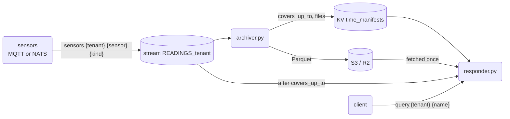

# 16 — sensor readings to Parquet, and questions over them

Sensors send readings. They never touch PostgreSQL: a NATS stream per tenant keeps them for a day, an
**archiver** writes them to Parquet files in S3 (Cloudflare R2, or any S3), and a
**responder** answers questions from those files plus the readings that came after.



## The rules that keep it safe

- **Files first, manifest second.** The archiver uploads a file, checks it is there, and only
  then writes the manifest. Killed in between, the file is an orphan nobody reads, and the
  next archiver covers the same readings again.
- **The manifest is the archiver's position.** `covers_up_to` is the last stream sequence in
  a file. The archiver keeps no consumer of its own: it restarts from the next sequence.
- **One stream per tenant.** The bridge makes `READINGS_<tenant>` for every tenant, at boot and
  when a tenant appears. A credential can then be held to one tenant by the stream's name.
- **One archiver per tenant.** The manifest is written on the revision the archiver read, so a
  second archiver fails at its first flush and stops.
- **Started early, it waits.** Before the tenant has a row in `zebridge_user_tenants`, its
  stream does not exist: the archiver says so once, checks every 10 seconds, and starts the
  moment the bridge makes the stream.
- **No silent hole.** The archiver refuses to start when the stream no longer holds
  `covers_up_to + 1`, or when it keeps readings for less than two flushes plus the S3 outage
  to survive (`--outage-s`, one hour by default).
- **Each program has its own credential.** A sensor publishes its own readings and nothing
  else; the archiver reads its tenant's stream and writes its tenant's manifest; the responder
  reads both and writes neither ([DEPLOYMENT](../../DEPLOYMENT.md), "Sensors and their archive").
- **Counted once.** The responder reads Parquet up to `covers_up_to` and the stream after it.
  When the manifest moves, the new files join and the hot rows they cover leave. A reading
  sent twice (same sensor, kind and sensor time) counts once.

## Run it

You need the dev stack's NATS, a local S3 and Python with `nats-py`, `boto3` and `duckdb`.
For S3 locally, SeaweedFS (MinIO no longer publishes images), keys generated into a 0600 file:

```sh
docker run -d --name zb-s3 -p 127.0.0.1:8333:8333 -v zb-s3-data:/data \
  -v ~/.config/zebridge/s3.json:/etc/seaweedfs/s3.json:ro \
  chrislusf/seaweedfs server -dir=/data -s3 -s3.config=/etc/seaweedfs/s3.json
```

`s3.json` is SeaweedFS's identity file: `{"identities": [{"name": "dev", "actions": ["Admin",
"Read", "Write", "List"], "credentials": [{"accessKey": "…", "secretKey": "…"}]}]}`. The
scripts read the keys from it (`S3_KEYS`) unless `AWS_ACCESS_KEY_ID` and
`AWS_SECRET_ACCESS_KEY` are set.

As containers, one of each per tenant on the hub: `ghcr.io/ndrean/zebridge-archiver` and
`ghcr.io/ndrean/zebridge-readings-responder` ([deploy/archiver.Dockerfile](../../deploy/archiver.Dockerfile)
and [deploy/readings-responder.Dockerfile](../../deploy/readings-responder.Dockerfile) show the
`docker run`). Both wait for a tenant's stream that does not exist yet, and stop with a one-line
reason on a missing setting (`NATS_URL`, the S3 key pair, the creds file).
From the repository, with creds minted from `operator.store` (`--mint-archiver`, `--mint-responder`):

```sh
export NATS_URL=tls://nats.example.com:4222 PYTHONPATH=zb-python/src
NATS_CREDS=archiver-acme.creds python3 examples/16-archive/archiver.py --tenant acme --flush-s 60 &
python3 examples/16-archive/responder.py --tenant acme --creds readings-acme.creds --cache /var/cache/zb-readings &
```

The bridge has made the stream `READINGS_acme` and the bucket `time_manifests`; the S3 bucket
must exist. Against R2: `S3_ENDPOINT=https://<account>.r2.cloudflarestorage.com`,
`S3_BUCKET=zb-events`, and an R2 API token's keys: read and write for the archiver, read only
for the responder.

Readings come from anything that publishes on `sensors.<tenant>.<sensor>.<kind>`: a sensor
with `--mint-sensor` creds, over NATS or MQTT (its JWT as the password), or 09-event's
`mqtt_sensors.py` for the tenant `globex`.

On the dev stack, whose NATS accounts are made by `nsc` rather than `--init-nats`, the
responder and archiver grants do not include readings: give both the bridge's creds with
`NATS_CREDS=scripts/native/creds/bridge.creds` (the responder still answers with its own).

## Questions

| name | parameters | answer |
| --- | --- | --- |
| `count` | none | `rows`, `archived`, `hot`, `covers_up_to`, `files` |
| `per_minute` | `kind`, `minutes` (10) | `columns`, `rows`: readings and average per minute |
| `latest` | `kind` | `columns`, `rows`: each sensor's last value |

## Tested

`scripts/scenarios/archive.py` runs the failure cases: every reading archived once, a kill
between upload and manifest, two archivers at once, the stream pruned past the archive, and
the responder counting each reading once while the boundary moves.
`scripts/scenarios/readings_roles.py` runs both programs with their own credentials on a stack
made by `--init-nats operator`, and checks what each role may and may not do.

## Measured

`python3 examples/16-archive/bench.py` (needs `nats-server` on the PATH, `nats-py` and `duckdb`) runs the archiver's own code on a local stream and times each stage, S3 left out. One run, on a 4-core sandbox with NATS on loopback, 500,000 readings of about 100 bytes (DuckDB 1.5.5, nats-py 2.16, nats-server 2.15.1; the container pins nats-py 2.15.0), numbers rounded:

| stage | rate | per unit |
| --- | --- | --- |
| ingest: `next_msg` + `common.reading()` + the dict (the archiver's loop) | 24–28k readings/s | 36–42 µs |
| of which `next_msg` alone | 39–40k/s | 25 µs |
| of which `reading()` alone (subject split, `json.loads`, metadata) | 78–81k/s | 12–13 µs |
| a batched pull, `fetch(5000)`, no decoding (the most nats-py can deliver) | 46–48k/s | |
| flush: JSON lines → DuckDB → Parquet (zstd), a warm process | 140–300k rows/s | 0.35–0.7 s per 100,000 rows |

What it says:

- **Ingestion is the limit**, about 8 times the cost of the flush: 500,000 readings take about 20 s to read and 2–3 s to write. One archiver serves one tenant, and 25k readings/s sustained is over two billion readings a day, so this is not a bottleneck for a plausible sensor fleet.
- **A flush stops the loop** (the archiver reads and writes in turn): 0.35–0.7 s per default batch of 100,000. The stream holds the readings meanwhile, and its retention is checked at start against two flushes plus the S3 outage.
- **Most of the ingest cost is Python**, not the work: even a batched pull stops near 48k/s. A client in another language would be the way past about 40k readings/s; that has not been built or measured, so the figure to beat is the table above.
- **The flush has little to gain.** Writing the JSON lines to disk and reading them back is the larger part of it, but replacing them with CSV gained 25–40% in a same-process comparison and was not adopted: it changes how strings, empty values and NaN are parsed for a stage that is not the limit. DuckDB writing Parquet from columns already in memory is an order of magnitude faster, which only matters if the rows were produced in columnar form to begin with.
- **Not measured:** the S3 upload (R2, SeaweedFS), real sensor traffic and its shapes (many sensors, wide payloads), a stream that has fallen behind (catch-up reads), memory (`rows` holds a whole batch as Python dicts), and the responder.

For scale, a bulk export of table rows to Parquet is a different workload: it reads a table in blocks and writes columns, with no per-message round trip. That is where figures in the millions of rows per second belong; the archiver pays one stream message per reading.

## Not yet

- **The archive lag** on the bridge's `/metrics`: how far each tenant's archive is behind
  its stream.
- **Compaction**: many small files merged into hourly or daily ones, the old ones deleted
  after a grace period.
- **The registry join**: business tables from PostgreSQL (sensors, zones, thresholds),
  replicated by libzb, joined with the readings in the same DuckDB.
- **No bucket key on the responder**: a Worker in front of R2 (with an R2 binding, like a
  tiles Worker) that checks the tenant before serving a file.
