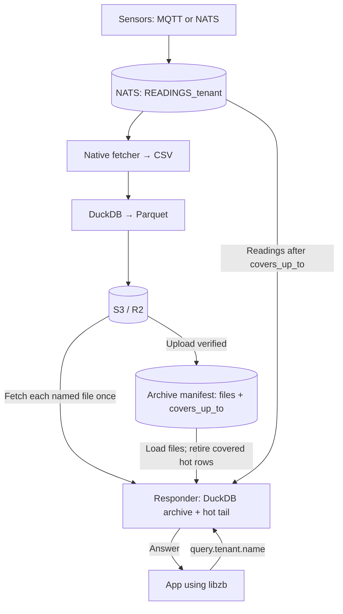

# 16 — sensor readings: live queries and a Parquet archive

Send sensor readings over MQTT or NATS. Query recent readings from DuckDB, and keep their history as Parquet files in S3 or Cloudflare R2. Sensor readings do not pass through PostgreSQL.

Two processes run for each tenant:

- **The archiver** reads the NATS stream with `bridge_readings_fetch`, converts each chunk to Parquet with DuckDB, and uploads it. A small Python process manages uploads and the archive manifest.
- **The responder** answers queries through libzb. Its DuckDB view combines archived files with recent readings from the stream.

## How it works



**Queries do not wait for Parquet.** The responder follows the stream and adds new readings to its hot tail. When an archive file becomes available, it loads the file and removes the hot rows that the file covers.

“Near realtime” means the delay from a reading arriving in NATS to that reading becoming queryable. That delay has not been benchmarked yet. The throughput figures below measure archiving capacity, not query freshness. The flush interval controls archive lag; it does not set the responder's query delay.

This example handles sensor messages. PostgreSQL CDC replication into DuckDB is a separate path; it does not use this archiver.

## Run it

You need NATS JetStream, an S3-compatible bucket, Python with `nats-py[nkeys]`, `boto3` and `duckdb`, and the native fetcher. The responder also needs [zb-python](../../zb-python) and libzb. The container images package these dependencies.

Build the fetcher from the repository root:

```sh
zig build readings-fetch -Doptimize=ReleaseFast
```

The bridge creates `READINGS_<tenant>` and the `time_manifests` bucket when the tenant is registered. Create the S3 bucket separately. Mint an archiver credential and a responder credential for the tenant; see [deployment](../../DEPLOYMENT.md).

Set the connection details and start both processes:

```sh
export NATS_URL=tls://nats.example.com:4222
export S3_ENDPOINT=https://ACCOUNT.r2.cloudflarestorage.com
export S3_BUCKET=zb-events
export AWS_ACCESS_KEY_ID=...
export AWS_SECRET_ACCESS_KEY=...
export PYTHONPATH=zb-python/src

NATS_CREDS=archiver-acme.creds python3 examples/16-archive/archiver.py \
  --tenant acme --fetch-bin zig-out/bin/bridge_readings_fetch --flush-s 60 &

python3 examples/16-archive/responder.py \
  --tenant acme --creds readings-acme.creds --cache /var/cache/zb-readings &
```

Use a write-capable S3 key for the archiver and a read-only key for the responder in production. For local SeaweedFS, use `S3_ENDPOINT=http://127.0.0.1:8333`; the scripts can read its keys from `~/.config/zebridge/s3.json` or `S3_KEYS`.

The fetcher is required. Put `bridge_readings_fetch` on `PATH`, set `ZB_READINGS_FETCH`, or pass `--fetch-bin`. There is no Python reader mode.

| Archiver option | Default | Purpose |
| --- | --- | --- |
| `--tenant` | Required | Tenant to archive |
| `--flush-s` | 60 seconds | Start a flush after readings have waited this long |
| `--batch` | 100,000 messages | Start earlier when a full batch is waiting; maximum messages per chunk |
| `--outage-s` | 3,600 seconds | S3 outage allowance used in the stream-retention check |
| `--fetch-bin` | `ZB_READINGS_FETCH` or `PATH` | Native fetcher executable |

For containers, use [deploy/archiver.Dockerfile](../../deploy/archiver.Dockerfile) and [deploy/readings-responder.Dockerfile](../../deploy/readings-responder.Dockerfile). Build them with the matching release packages in `dist/<version>/`. Each Dockerfile includes its build and run commands.

## Publish and query

Publish on `sensors.<tenant>.<sensor>.<kind>`, for example `sensors.acme.truck42.temperature`. The payload is either:

- A JSON number, such as `21.5`. Its timestamp is the stream's receipt time.
- An object with both keys: `{"value": 21.5, "ts_ms": 1790000000000}`. The timestamp is in milliseconds; `null` uses the stream's receipt time.

The value must be finite. A sensor timestamp must fall between 1970 and the end of year 9999. Invalid payloads are skipped, including quoted numbers, booleans, repeated keys, missing `ts_ms`, `NaN`, infinity, a byte-order mark and UTF-16. The native decoder and the responder's Python decoder follow the same contract.

Send requests through libzb to `query.<tenant>.<name>`:

| Name | Parameters | Answer |
| --- | --- | --- |
| `count` | `{}` | Total, archived and hot row counts; archive position; file count |
| `per_minute` | `{"kind": "temperature", "minutes": 10}` | Count and average per minute |
| `latest` | `{"kind": "temperature"}` | Latest value and timestamp for each sensor |

## Recovery and data integrity

- **Upload first, publish second.** A file enters the manifest only after its upload and size check succeed. A crash before the manifest commit leaves an unused file; restart reads the same stream range again.
- **Restart from the manifest.** `covers_up_to` records the last covered stream sequence, including skipped payloads. A skipped-only chunk advances this position without writing an empty file.
- **Detect missing history.** A gap before or inside a chunk stops archiving. Missing messages are never marked as archived. Stream retention must cover at least two flush intervals plus `--outage-s`.
- **Reject competing writers.** Manifest updates check the revision read by the archiver. A second writer stops when its revision is stale.
- **Count resent readings once.** The latest arrival wins for a given sensor, kind and sensor timestamp. The responder also deduplicates across files and its hot tail.
- **Wait for provisioning.** If the tenant's stream does not exist yet, both processes wait for it.

## Performance

Measured on the development Mac on 2026-10-27: 500,000 readings, local NATS, arm64 Python 3.13, DuckDB 1.5.5, nats-py 2.15.0, NATS Server 2.15.1 and a `ReleaseFast` fetcher.

| Stage | Former Python archive path | Native archive path |
| --- | --- | --- |
| Read and decode 500,000 readings | 22.12 s; 22,605 readings/s | 0.57–0.58 s; 859,000–873,000 readings/s |
| Convert 500,000 rows to Parquet | 421,000–461,000 rows/s, including JSON output | 3.64–3.86 million rows/s, including SQL deduplication |

The native read stage was about **38× faster**; Parquet conversion was about **8–9× faster**. Native process startup is included. Python ingest was measured once; native ingest and each conversion were measured three times.

These are separate stage measurements. They exclude S3 uploads, manifest commits and responder queries. Remote storage latency, query freshness and query throughput still need measurement.

Reproduce with the listed Python dependencies:

```sh
ZB_READINGS_FETCH=zig-out/bin/bridge_readings_fetch python3 examples/16-archive/bench.py 500000
```

The benchmark retains the former Python implementation as a baseline. The archiver itself uses only the native fetcher. The Dockerfiles pin DuckDB's Python package to 1.5.5; the installed DuckDB CLI is separate, and these figures do not measure DuckDB 2.0.

## Tests

- [archive.py](../../scripts/scenarios/archive.py): upload interruption, competing writers, retention loss, startup before provisioning, inaccessible files and queries during archive handover. Run with `--fetch-bin /path/to/bridge_readings_fetch`.
- [readings_fetch.py](../../scripts/scenarios/readings_fetch.py): decoder parity with the responder, sequence gaps, skipped-only chunks, restart coverage and archived rows across chunk sizes.
- [readings_roles.py](../../scripts/scenarios/readings_roles.py): archiver, responder and sensor permissions with real credentials.
- `python -m unittest discover -s scripts/scenarios -p test_archive_readers.py`: coverage and manifest regressions without external services.

## Next steps

Measure arrival-to-query latency and archive lag under load, expose archive lag in metrics, and add file compaction. A further example could join readings with sensor metadata replicated from PostgreSQL into the responder's DuckDB.
