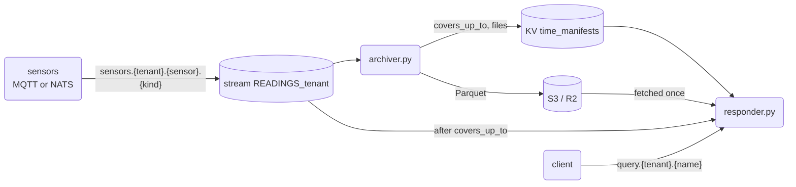

# 16 — sensor readings to Parquet, and questions over them

Sensors send readings. They never touch PostgreSQL: a NATS stream per tenant keeps them for a day, an
**archiver** writes them to Parquet files in S3 (Cloudflare R2, or any S3), and a
**responder** answers questions from those files plus the readings that came after.



## The rules that keep it safe

- **Files first, manifest second.** The archiver uploads a file, checks it is there, and only
  then writes the manifest. Killed in between, the file is an orphan nobody reads, and the
  next archiver covers the same readings again.
- **The manifest is the archiver's position.** `covers_up_to` is the last stream sequence in
  a file. The archiver keeps no consumer of its own: it restarts from the next sequence.
- **One stream per tenant.** The bridge makes `READINGS_<tenant>` for every tenant, at boot and
  when a tenant appears. A credential can then be held to one tenant by the stream's name.
- **One archiver per tenant.** The manifest is written on the revision the archiver read, so a
  second archiver fails at its first flush and stops.
- **Started early, it waits.** Before the tenant has a row in `zebridge_user_tenants`, its
  stream does not exist: the archiver says so once, checks every 10 seconds, and starts the
  moment the bridge makes the stream.
- **No silent hole.** The archiver refuses to start when the stream no longer holds
  `covers_up_to + 1`, or when it keeps readings for less than two flushes plus the S3 outage
  to survive (`--outage-s`, one hour by default).
- **Each program has its own credential.** A sensor publishes its own readings and nothing
  else; the archiver reads its tenant's stream and writes its tenant's manifest; the responder
  reads both and writes neither ([DEPLOYMENT](../../DEPLOYMENT.md), "Sensors and their archive").
- **Counted once.** The responder reads Parquet up to `covers_up_to` and the stream after it.
  When the manifest moves, the new files join and the hot rows they cover leave. A reading
  sent twice (same sensor, kind and sensor time) counts once.

## The payload

A reading is a message on `sensors.<tenant>.<sensor>.<kind>` (exactly four tokens) whose payload is:

- a JSON number: the value, taken at the time the stream received it; or
- `{"value": <number>, "ts_ms": <integer | float | null>}`, both keys present: the value and the sensor's own
  time in milliseconds (`null` takes the stream's time). A time before 1970 or after the year 9999 is no time.

Anything else is **skipped**, not guessed and not a crash, and the archive's position moves past it: a
quoted number (`"21.5"`), a boolean, `NaN` or `Infinity`, a number that overflows (`1e999`), an object missing
`ts_ms` or repeating a key, a byte-order mark or UTF-16. The rules are the same in
[`common.reading()`](common.py) (the responder's hot tail and `--reader python`) and in
[`src/readings_decode.zig`](../../src/readings_decode.zig) (`--reader native`), so a reading is archived
exactly when it is counted. [`scripts/scenarios/readings_fetch.py`](../../scripts/scenarios/readings_fetch.py) feeds
both the same awkward and generated payloads and compares them, row by row.

## Run it

You need the dev stack's NATS, a local S3 and Python with `nats-py`, `boto3` and `duckdb`.
For S3 locally, SeaweedFS (MinIO no longer publishes images), keys generated into a 0600 file:

```sh
docker run -d --name zb-s3 -p 127.0.0.1:8333:8333 -v zb-s3-data:/data \
  -v ~/.config/zebridge/s3.json:/etc/seaweedfs/s3.json:ro \
  chrislusf/seaweedfs server -dir=/data -s3 -s3.config=/etc/seaweedfs/s3.json
```

`s3.json` is SeaweedFS's identity file: `{"identities": [{"name": "dev", "actions": ["Admin",
"Read", "Write", "List"], "credentials": [{"accessKey": "…", "secretKey": "…"}]}]}`. The
scripts read the keys from it (`S3_KEYS`) unless `AWS_ACCESS_KEY_ID` and
`AWS_SECRET_ACCESS_KEY` are set.

As containers, one of each per tenant on the hub: `ghcr.io/ndrean/zebridge-archiver` and
`ghcr.io/ndrean/zebridge-readings-responder` ([deploy/archiver.Dockerfile](../../deploy/archiver.Dockerfile)
and [deploy/readings-responder.Dockerfile](../../deploy/readings-responder.Dockerfile) show the
`docker run`). Both wait for a tenant's stream that does not exist yet, and stop with a one-line
reason on a missing setting (`NATS_URL`, the S3 key pair, the creds file).
From the repository, with creds minted from `operator.store` (`--mint-archiver`, `--mint-responder`):

```sh
export NATS_URL=tls://nats.example.com:4222 PYTHONPATH=zb-python/src
NATS_CREDS=archiver-acme.creds python3 examples/16-archive/archiver.py --tenant acme --flush-s 60 &
python3 examples/16-archive/responder.py --tenant acme --creds readings-acme.creds --cache /var/cache/zb-readings &
```

The bridge has made the stream `READINGS_acme` and the bucket `time_manifests`; the S3 bucket
must exist. Against R2: `S3_ENDPOINT=https://<account>.r2.cloudflarestorage.com`,
`S3_BUCKET=zb-events`, and an R2 API token's keys: read and write for the archiver, read only
for the responder.

**Two readers.** `--reader python` (the default) reads the stream with nats-py in the archiver's own process.
`--reader native` runs `bridge_readings_fetch`, built with the bridge (`zig build`, or `zig build readings-fetch`
for it alone; it needs no PostgreSQL library), which writes a range of the stream as CSV; DuckDB then makes the
Parquet, dropping resent readings in SQL. Same files, same manifest, same rules, about ten times the throughput
(see Measured). Put the binary on the PATH or pass `--fetch-bin` (or `ZB_READINGS_FETCH`):

```sh
python3 examples/16-archive/archiver.py --tenant acme --reader native --fetch-bin zig-out/bin/bridge_readings_fetch
```

The default stays `python` until the native reader has run on your stack: the container image
([deploy/archiver.Dockerfile](../../deploy/archiver.Dockerfile)) does not carry the binary yet.

Readings come from anything that publishes on `sensors.<tenant>.<sensor>.<kind>`: a sensor
with `--mint-sensor` creds, over NATS or MQTT (its JWT as the password), or 09-event's
`mqtt_sensors.py` for the tenant `globex`.

On the dev stack, whose NATS accounts are made by `nsc` rather than `--init-nats`, the
responder and archiver grants do not include readings: give both the bridge's creds with
`NATS_CREDS=scripts/native/creds/bridge.creds` (the responder still answers with its own).

## Questions

| name | parameters | answer |
| --- | --- | --- |
| `count` | none | `rows`, `archived`, `hot`, `covers_up_to`, `files` |
| `per_minute` | `kind`, `minutes` (10) | `columns`, `rows`: readings and average per minute |
| `latest` | `kind` | `columns`, `rows`: each sensor's last value |

## Tested

`scripts/scenarios/archive.py` runs the failure cases: every reading archived once, a kill
between upload and manifest, two archivers at once, the stream pruned past the archive, and
the responder counting each reading once while the boundary moves.
`scripts/scenarios/readings_fetch.py` runs the native reader on a bare nats-server: the same payloads through
both decoders, chunks that cover the stream with no gap, the empty range, a missing stream, a pruned one, the
dedupe, and (with a local S3) the whole archiver with each reader leaving the same rows.
`scripts/scenarios/readings_roles.py` runs both programs with their own credentials on a stack
made by `--init-nats operator`, and checks what each role may and may not do.

## Measured

`python3 examples/16-archive/bench.py` (needs `nats-server` on the PATH, `nats-py` and `duckdb`, and for the native
rows a `ReleaseFast` `bridge_readings_fetch`) runs the archiver's own code on a local stream and times each stage, S3
left out. Ranges over several runs on a 4-core sandbox with NATS on loopback, 500,000 readings of about 100 bytes
(DuckDB 1.5.5, nats-py 2.16, nats-server 2.15.1; the container pins nats-py 2.15.0), rounded. The machine is shared
and noisy: read the ratios, not the digits.

| stage | `--reader python` | `--reader native` |
| --- | --- | --- |
| read the stream and decode each reading | 22–28k readings/s (36–45 µs each) | 370–560k readings/s (the whole process, start included, 1.1–1.4 s for 500,000) |
| of which `next_msg` alone / a batched pull with no decoding | 39–41k/s / 40–48k/s | |
| turn them into Parquet (zstd) and drop resent readings | 125–300k rows/s (JSON lines through DuckDB) | 1.4–1.7M rows/s (the CSV through DuckDB, dedupe in SQL) |
| upload and size check of that file, to a local SeaweedFS 4.51 on loopback | 30–280 ms (the first is the slowest), 3–13% of a flush | the same |

`archiver.py` end to end, 500,000 readings, a real S3 (SeaweedFS), `--flush-s 1`: **26.8 s with `--reader python`, 3.0 s with
`--reader native`** (about 9 times faster by wall clock, 13 times on rows per second without the 1 s idle exit). The native
run wrote 5 files (a chunk is 100,000 messages), the Python one 22 (a flush every second).

What it says:

- **The read was the limit**: 8 times the cost of the flush with nats-py, and most of it is Python itself (even a batched pull stops
  near 48k/s). Natively, decoding costs about 5% over a bare pull, and the read and the Parquet are of the same order.
- **The rest is DuckDB and S3.** After the change a 100,000-message chunk is read in about 0.25 s and written in about 0.1 s. A remote
  bucket adds its round trip, which loopback does not show.
- **A cycle stops the loop**, as before: it reads a chunk, writes it, uploads it, writes the manifest, and only then reads again. The stream
  holds the readings meanwhile; its retention is checked at start against two flushes plus the S3 outage.
- **Not measured:** a remote S3 (R2), real sensor traffic and its shapes (many sensors, wide payloads), a stream that has fallen far behind
  (catch-up reads), the memory of a large chunk, the container image (it does not carry the binary yet), and the responder.
- The flush with CSV in place of JSON lines, tried alone while the reader was still nats-py, gained only 25–40% and was not worth changing;
  with the native reader the CSV comes for free.

For scale, a bulk export of table rows to Parquet is a different workload: it reads a table in blocks and writes columns, with no per-message
round trip. That is where figures in the millions of rows per second belong; the archiver pays one stream message per reading.

## Not yet

- **The archive lag** on the bridge's `/metrics`: how far each tenant's archive is behind
  its stream.
- **Compaction**: many small files merged into hourly or daily ones, the old ones deleted
  after a grace period.
- **The registry join**: business tables from PostgreSQL (sensors, zones, thresholds),
  replicated by libzb, joined with the readings in the same DuckDB.
- **No bucket key on the responder**: a Worker in front of R2 (with an R2 binding, like a
  tiles Worker) that checks the tenant before serving a file.
